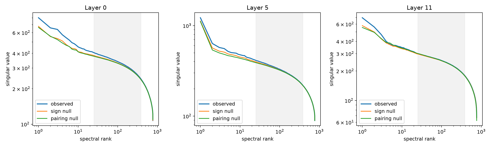

# Independent-checkpoint replication of full tensor spectra

This repeats the frozen full-width tensor-map spectrum and coordination-null analysis on `Elriggs/gpt2-bilinear-sqrd-attn-12l-6h-768embd` at commit `51690b862c026c600ee0645e8dd5474f43ef3f64` (12 layers, width 768, six heads, training step 6484). It is an independently trained checkpoint, not another corpus or layer from the 18-layer model.

## Locked hypotheses

- **P1_powerlaw_bulk_replicates: supported.**
- **P2_nulls_retain_bulk: supported.**
- **P3_late_has_four_strict_spikes: not supported.**
- **P4_late_exceeds_coordination_nulls: supported.**
- **P5_late_is_more_concentrated: not supported.**
- **P6_middle_lacks_strict_spikes: not supported.**
- **P7_depth_excess_pattern_replicates: not supported.**

| Layer | Alpha / R² | Top excesses | Mean top-4 | Top-4 energy | Sign / pairing null mean |
|---:|---:|---:|---:|---:|---:|
| 0 | 0.195 / 0.956 | -0.020 / -0.084 / -0.035 / -0.084 | -0.056 | 0.034 | -0.129 / -0.129 |
| 5 | 0.242 / 0.967 | 0.217 / -0.270 / -0.274 / -0.232 | -0.140 | 0.053 | -0.171 / -0.182 |
| 11 | 0.198 / 0.947 | 0.117 / 0.037 / -0.059 / -0.163 | -0.017 | 0.040 | -0.112 / -0.148 |

The power-law fit and spike criterion are deliberately unchanged in form but rescaled in rank window for width 768. Replication of a late spike would establish an architectural/training-family regularity; it would still require natural-state and causal validation before being called a circuit.
