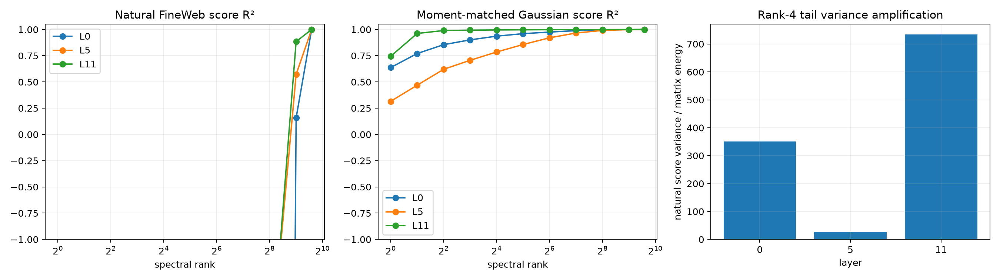

# Fourth-moment diagnostic of covariance-cleaned spectra (superseded)

> **Do not treat the dramatic natural-state failure below as a validated fourth-moment result.** This pilot estimated a 768-dimensional covariance from only 1,024 states. The later [sample-size and ridge stability red team](BILIN12_CLEANING_STABILITY_REDTEAM.md) showed that held-out whitening mismatch strongly predicts the apparent failure and that the result changes substantially with more samples and regularization. This page is retained as the motivating diagnostic, not the conclusion.

Each raw outlier form is expressed in a FineWeb second-moment-whitened coordinate system. The same frozen spectral truncations are scored on disjoint FineWeb states and on Gaussian states matched to the whitened discovery mean and second moment. Under a Gaussian model, trace-cleaned Frobenius energy should predict quadratic-score variance; a natural-data gap diagnoses higher-order structure rather than an algebra or transform error.

## Locked hypotheses

- **Q1_gaussian_rank4_matches_matrix_energy: not supported.**
- **Q2_natural_rank4_is_worse: supported.**
- **Q3_natural_scores_need_more_modes: supported.**
- **Q4_low_energy_tail_is_naturally_amplified: supported.**
- **Q5_full_rank_reconstructs_both: supported.**
- **Q6_fourth_moment_gap_is_depth_general: supported.**

| Layer | Median matrix energy@4 | Natural / Gaussian R²@4 | Natural corr@4 | Natural rank corr≥.90 | Tail amplification |
|---:|---:|---:|---:|---:|---:|
| 0 | 0.920 | -37.105 / 0.855 | 0.225 | 768 | 350.1× |
| 5 | 0.837 | -3.659 / 0.620 | 0.504 | 768 | 26.6× |
| 11 | 0.994 | -3.459 / 0.990 | 0.517 | 512 | 734.2× |

Covariance-cleaned Frobenius compactness is a Gaussian/second-moment statement. Empirical quadratic-score compactness is a fourth-moment statement. They are distinct explanatory objects even when the whitening transform is exact.
