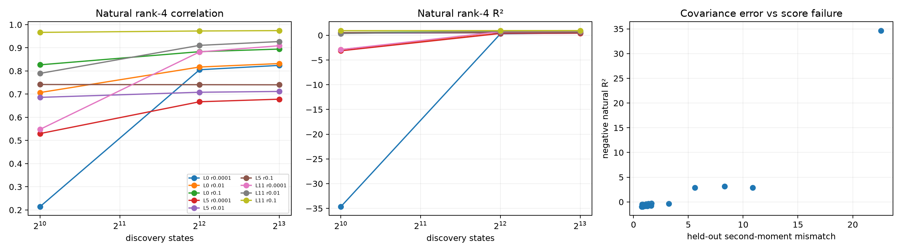

# Sample-size and ridge red-team of covariance cleaning

The independent checkpoint's cleaned-form anomaly is repeated over 1,024, 4,096, and 8,192 FineWeb discovery states and ridge fractions from `1e-4` to `0.1`. Held-out whitened second-moment mismatch is measured explicitly, so covariance-estimation failure can be separated from residual higher-order effects.

## Locked hypotheses

- **S1_more_discovery_data_improves_natural_fit: supported.**
- **S2_ridge_stabilizes_small_sample_fit: supported.**
- **S3_stable_cleaning_reaches_high_correlation: not supported.**
- **S4_natural_gaussian_gap_survives: not supported.**
- **S5_no_universal_rank4_setting: supported.**
- **S6_second_moment_mismatch_predicts_failure: supported.**

| Layer | States | Ridge | Second-moment mismatch | Natural corr / R² | Gaussian R² |
|---:|---:|---:|---:|---:|---:|
| 0 | 1024 | 0.0001 | 22.58 | 0.214 / -34.649 | 0.858 |
| 0 | 1024 | 0.01 | 5.59 | 0.707 / -2.880 | 0.863 |
| 0 | 1024 | 0.1 | 1.28 | 0.827 / 0.542 | 0.833 |
| 0 | 4096 | 0.0001 | 1.62 | 0.805 / 0.296 | 0.860 |
| 0 | 4096 | 0.01 | 1.41 | 0.817 / 0.406 | 0.856 |
| 0 | 4096 | 0.1 | 0.86 | 0.883 / 0.730 | 0.835 |
| 0 | 8192 | 0.0001 | 1.25 | 0.824 / 0.464 | 0.863 |
| 0 | 8192 | 0.01 | 1.14 | 0.832 / 0.536 | 0.861 |
| 0 | 8192 | 0.1 | 0.81 | 0.895 / 0.746 | 0.844 |
| 5 | 1024 | 0.0001 | 8.32 | 0.530 / -3.135 | 0.606 |
| 5 | 1024 | 0.01 | 1.30 | 0.686 / 0.426 | 0.562 |
| 5 | 1024 | 0.1 | 0.81 | 0.742 / 0.538 | 0.299 |
| 5 | 4096 | 0.0001 | 1.37 | 0.667 / 0.371 | 0.605 |
| 5 | 4096 | 0.01 | 0.83 | 0.708 / 0.500 | 0.541 |
| 5 | 4096 | 0.1 | 0.80 | 0.741 / 0.537 | 0.286 |
| 5 | 8192 | 0.0001 | 1.13 | 0.678 / 0.419 | 0.603 |
| 5 | 8192 | 0.01 | 0.79 | 0.712 / 0.506 | 0.539 |
| 5 | 8192 | 0.1 | 0.80 | 0.740 / 0.535 | 0.295 |
| 11 | 1024 | 0.0001 | 10.88 | 0.548 / -2.886 | 0.989 |
| 11 | 1024 | 0.01 | 3.22 | 0.790 / 0.357 | 0.988 |
| 11 | 1024 | 0.1 | 0.84 | 0.967 / 0.934 | 0.982 |
| 11 | 4096 | 0.0001 | 1.59 | 0.882 / 0.727 | 0.990 |
| 11 | 4096 | 0.01 | 1.27 | 0.911 / 0.808 | 0.989 |
| 11 | 4096 | 0.1 | 0.76 | 0.973 / 0.945 | 0.983 |
| 11 | 8192 | 0.0001 | 1.26 | 0.909 / 0.804 | 0.990 |
| 11 | 8192 | 0.01 | 1.08 | 0.927 / 0.849 | 0.989 |
| 11 | 8192 | 0.1 | 0.75 | 0.974 / 0.948 | 0.982 |

A stable covariance metric requires both enough discovery states and adequate regularization. Any remaining natural-versus-Gaussian gap after second-moment stabilization is evidence about empirical fourth moments; the unstable small-sample gap is not.
