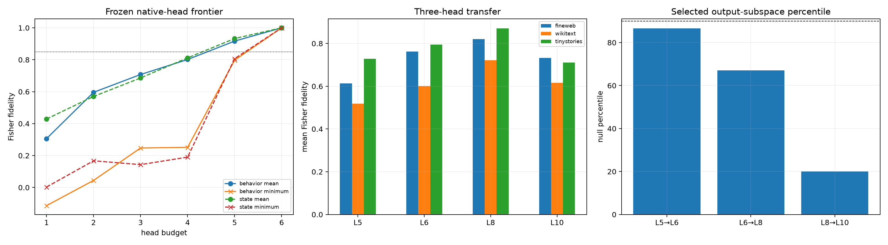

# Final-destination native-head program

FineWeb selection examples choose exact subsets of the six native attention heads at Layers 5, 6, 8, and 10. Only each head's changed write at the final prediction destination is inserted. Frozen subsets are evaluated on disjoint FineWeb, WikiText, and TinyStories examples at source distances 8, 32, and 64. Behavior-selected subsets optimize downstream Fisher fidelity; state-selected subsets optimize Euclidean write reconstruction.

## Locked hypotheses

- **H1_head_recomposition_is_exact: not supported.**
- **H2_two_behavior_selected_heads_are_useful: not supported.**
- **H3_three_behavior_selected_heads_are_nearly_sufficient: not supported.**
- **H4_behavior_selection_beats_state_selection: not supported.**
- **H5_head_program_transfers_ood: not supported.**
- **H6_previously_recurrent_heads_are_selected: supported.**
- **H7_native_head_program_is_sparse: not supported.**
- **H8_four_heads_are_sufficient: not supported.**
- **H9_selected_output_subspaces_are_weight_aligned: not supported.**

The strict recomposition gate failed only numerically: maximum relative state
error is `1.47e-05` and maximum propagated-logit disagreement is `2.69e-05`.
In a float64 spot check, splitting the output projection by heads recomposed to
relative error below `2.4e-16`. The failure is retained because the
preregistered runtime threshold was `1e-6`.

## Selected programs

| Layer | Behavior K2 | State K2 | Behavior K3 | State K3 |
|---:|---|---|---|---|
| 5 | [1, 2] | [2, 3] | [1, 2, 3] | [0, 2, 3] |
| 6 | [1, 5] | [1, 5] | [1, 4, 5] | [1, 4, 5] |
| 8 | [3, 5] | [2, 3] | [2, 3, 5] | [0, 2, 3] |
| 10 | [0, 1] | [0, 2] | [0, 1, 2] | [0, 1, 2] |

## Held-out frontier

| Budget | Behavior mean / min | State mean / min |
|---:|---:|---:|
| 1 | 0.306 / -0.114 | 0.429 / 0.003 |
| 2 | 0.596 / 0.044 | 0.570 / 0.167 |
| 3 | 0.708 / 0.248 | 0.686 / 0.143 |
| 4 | 0.802 / 0.252 | 0.812 / 0.190 |
| 5 | 0.917 / 0.797 | 0.933 / 0.807 |
| 6 | 1.000 / 1.000 | 1.000 / 1.000 |

## Weight-only output-subspace control

| Layers | Selected overlap | Null mean / p90 | Percentile |
|---|---:|---:|---:|
| 5→6 | 0.410 | 0.382 / 0.413 | 86.7 |
| 6→8 | 0.358 | 0.346 / 0.382 | 67.1 |
| 8→10 | 0.321 | 0.357 / 0.443 | 20.0 |

## Worked Layer-8 example

Context around edit: ` sounds pretty good.
Brian Duensing: After repeatedly flopping as a starter the plan was for Duensing to move back into the bullpen and rediscover his previous success as a reliever. Instead he's mostly struggled, against both righties and`

Original token `' back'` is replaced by newline. Frozen heads [3, 5] achieve Fisher fidelity 0.895 for the full six-head final-destination message.

| Token | Full logit change | Sparse-head change |
|---|---:|---:|
| `
` | 1.852 | 1.881 |
| `<\|endoftext\|>` | 1.328 | 1.327 |
| `)\|` | -0.672 | -0.677 |
| `),"` | -0.562 | -0.622 |
| `.")` | -0.550 | -0.597 |
| `.}` | -0.543 | -0.568 |
| `?".` | -0.523 | -0.559 |
| `)."` | -0.478 | -0.538 |

A native-head program is an intervention interface, not a claim that a head has one semantic meaning. Agreement with a weight-only output subspace would support a recurring structural module; disagreement would mean functional recurrence is implemented by differently oriented head bases.
