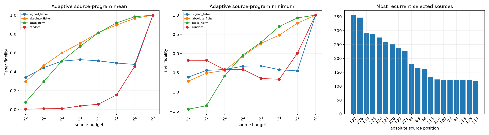

# Final-destination source-edge program

Each selected layer's final-destination attention-message difference is decomposed exactly into 128 additive source-position writes, retaining the native squared QK weights, current values, persistent value bus, heads, and output projection. A downstream Fisher gradient at the base message ranks source edges per example; the resulting finite source subsets are then patched through the nonlinear suffix. State-norm, absolute-gradient, and random rankings are controls.

## Locked hypotheses

- **E1_source_recomposition_is_numerically_exact: not supported.**
- **E2_sixteen_fisher_sources_are_useful: not supported.**
- **E3_sixtyfour_fisher_sources_are_robustly_sufficient: not supported.**
- **E4_behavioral_ranking_beats_state_ranking: not supported.**
- **E5_signed_ranking_beats_absolute_ranking: not supported.**
- **E6_source_program_is_conditionally_sparse: supported.**
- **E7_the_edited_source_alone_is_not_sufficient: supported.**
- **E8_selected_sources_are_geometrically_local: not supported.**
- **E9_local_gradient_predicts_finite_projection: supported.**
- **E10_a_small_global_source_skeleton_recurs: not supported.**

The exact source sum missed the locked `1e-5` runtime threshold by float32
reassociation: maximum relative write error is `1.53e-05`, while maximum
propagated-logit disagreement is `2.67e-05`. This is retained as a numerical
gate failure, not interpreted as a missing source term.

## Held-out finite frontier

| Budget | Signed Fisher mean/min | Absolute Fisher mean/min | State norm mean/min | Random mean/min |
|---:|---:|---:|---:|---:|
| 1 | 0.341/-0.613 | 0.297/-0.720 | 0.078/-1.448 | 0.005/-0.175 |
| 2 | 0.444/-0.438 | 0.466/-0.511 | 0.298/-1.357 | 0.009/-0.175 |
| 4 | 0.514/-0.416 | 0.601/-0.440 | 0.515/-0.583 | 0.011/-0.422 |
| 8 | 0.529/-0.330 | 0.702/-0.071 | 0.670/-0.042 | 0.039/-0.411 |
| 16 | 0.517/-0.320 | 0.815/0.266 | 0.812/0.294 | 0.057/-0.647 |
| 32 | 0.493/-0.419 | 0.895/0.479 | 0.918/0.703 | 0.155/-0.670 |
| 64 | 0.478/-0.452 | 0.966/0.792 | 0.983/0.929 | 0.458/0.010 |
| 128 | 1.000/1.000 | 1.000/1.000 | 1.000/1.000 | 1.000/1.000 |

Edited-source-only mean fidelity: **0.030**. Median absolute-score participation: **8.0** positions. Edit-neighborhood-or-final share of top-16 selections: **0.170**. Global top-16 source skeleton share: **0.392**. Local-gradient versus finite Fisher projection correlation: **0.999**.

Adaptive source selection is an oracle diagnostic because it uses the target message and its downstream target direction. Sparse success would demonstrate conditional edge sparsity, not a fixed reusable circuit. Failure would indicate that even the source contraction is broadly cooperative.
