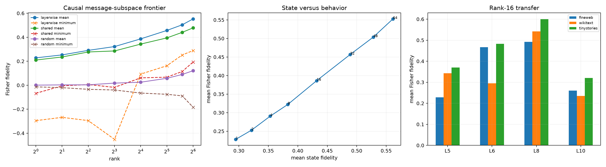

# Final-destination message-subspace audit

The six-head native program was not sparse, so this preregistered follow-up asks whether its summed final-destination message is compact in a non-native residual-space basis. Uncentered state PCA is fit on FineWeb message deltas. Layer-specific bases, one normalized pooled basis shared by all four layers, and matched random bases are frozen before evaluation on disjoint FineWeb, WikiText, and TinyStories examples.

## Locked hypotheses

- **P1_rank8_layerwise_basis_is_useful: not supported.**
- **P2_rank16_layerwise_basis_is_nearly_sufficient: not supported.**
- **P3_rank32_layerwise_basis_is_robustly_sufficient: not supported.**
- **P4_one_shared_rank32_basis_is_nearly_sufficient: not supported.**
- **P5_learned_basis_beats_random: supported.**
- **P6_state_variance_predicts_behavior_frontier: supported.**
- **P7_layerwise_orientation_matters: not supported.**
- **P8_rank16_layerwise_basis_transfers_ood: not supported.**
- **P9_non_native_basis_beats_three_native_heads: not supported.**

## Held-out causal frontier

| Rank | Layerwise mean / min | Shared mean / min | Random mean / min | State mean |
|---:|---:|---:|---:|---:|
| 1 | 0.228 / -0.295 | 0.210 / -0.067 | 0.001 / -0.014 | 0.295 |
| 2 | 0.253 / -0.268 | 0.235 / -0.005 | 0.003 / -0.021 | 0.321 |
| 4 | 0.291 / -0.295 | 0.277 / 0.005 | 0.003 / -0.034 | 0.353 |
| 8 | 0.322 / -0.451 | 0.286 / -0.018 | 0.017 / -0.040 | 0.383 |
| 16 | 0.386 / 0.093 | 0.343 / 0.061 | 0.025 / -0.066 | 0.432 |
| 32 | 0.457 / 0.162 | 0.394 / 0.067 | 0.058 / -0.076 | 0.489 |
| 48 | 0.504 / 0.252 | 0.441 / 0.114 | 0.090 / -0.089 | 0.528 |
| 64 | 0.553 / 0.289 | 0.478 / 0.193 | 0.121 / -0.183 | 0.561 |

## Rank-16 transfer

| Layer | FineWeb | WikiText | TinyStories |
|---:|---:|---:|---:|
| 5 | 0.228 | 0.343 | 0.370 |
| 6 | 0.467 | 0.295 | 0.483 |
| 8 | 0.492 | 0.542 | 0.600 |
| 10 | 0.260 | 0.235 | 0.321 |

The frozen three-native-head program averaged 0.708 Fisher fidelity; layerwise rank-16 PCA averaged 0.386. A PCA basis is a descriptive coordinate system learned from message deltas, not a native module. Its success would establish compact message geometry; it would not establish neuron or head monosemanticity.
