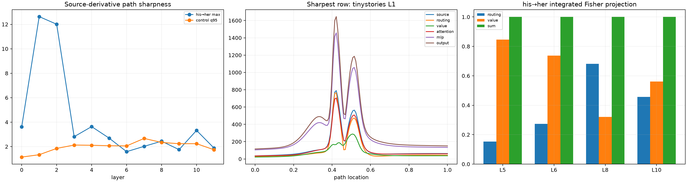

# Layer and factor localization of sharp semantic paths

For every gender edit, the dense embedding chord is differentiated through all twelve layers. Each final-destination source derivative is split exactly into attention-routing and value derivatives. Final-position attention, bilinear-MLP, and residual-output derivatives localize where path curvature becomes sharp. Dense factor integrals are then inserted causally at layers 5, 6, 8, and 10.

## Locked hypotheses

- **F1_routing_and_value_derivatives_recompose_each_source_jvp: supported.**
- **F2_dense_factor_integrals_recompose_the_finite_source_change: supported.**
- **F3_one_attention_factor_dominates_the_sharpest_local_peak: supported.**
- **F4_the_peak_contains_routing_value_cancellation: not supported.**
- **F5_the_sharpness_is_already_visible_before_layer_five: supported.**
- **F6_a_bilinear_mlp_peak_precedes_or_matches_the_attention_source_peak: not supported.**
- **F7_both_integrated_routing_and_value_have_behavioral_effects: not supported.**
- **F8_neither_factor_alone_explains_the_worst_condition: supported.**
- **F9_factor_peak_location_matches_the_direct_source_peak: supported.**
- **F10_matched_controls_have_lower_composed_source_sharpness: supported.**

| Layer | his→her max peak ratio | control q95 | routing projection | value projection | sum fidelity |
|---:|---:|---:|---:|---:|---:|
| 0 | 3.62 | 1.14 | — | — | — |
| 1 | 12.63 | 1.33 | — | — | — |
| 2 | 12.01 | 1.85 | — | — | — |
| 3 | 2.81 | 2.13 | — | — | — |
| 4 | 3.63 | 2.11 | — | — | — |
| 5 | 2.69 | 2.07 | 0.153 | 0.846 | 1.000 |
| 6 | 1.58 | 2.06 | 0.274 | 0.737 | 1.000 |
| 7 | 2.02 | 2.67 | — | — | — |
| 8 | 2.44 | 2.34 | 0.681 | 0.321 | 1.000 |
| 9 | 1.75 | 2.24 | — | — | — |
| 10 | 3.33 | 2.24 | 0.457 | 0.561 | 1.000 |
| 11 | 1.88 | 1.74 | — | — | — |

Sharpest row: **tinystories layer 1**. Routing/value norm shares there are **0.820/0.180**, with cosine **0.044**.

Routing/value derivatives are differential path factors, not unique global feature attributions. Their exact pointwise sum makes them useful for locating curvature; their individual finite downstream effects can still interact nonlinearly.
