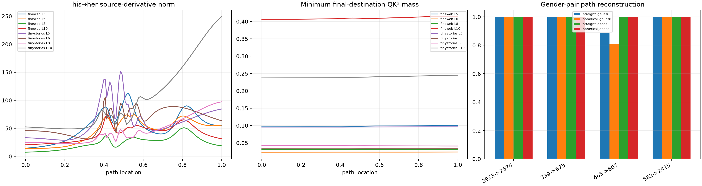

# Red team of the his→her path-integration outlier

Gauss-8 was nearly exact on most semantic edits but regressed on `his→her`, especially at layer 5 in TinyStories. This discovery-locked follow-up compares that pair with the other gender edits, samples 129 path points, records the final-destination squared-QK normalizer, and compares straight embedding chords with constant-norm spherical paths.

## Locked hypotheses

- **D1_gauss8_regression_is_concentrated_in_the_discovered_pair: supported.**
- **D2_the_discovered_path_has_an_unusually_sharp_derivative: supported.**
- **D3_sharpness_coincides_with_attention_normalizer_collapse: not supported.**
- **D4_dense_straight_path_integration_resolves_the_outlier: supported.**
- **D5_constant_norm_path_improves_low_order_quadrature: not supported.**
- **D6_gauss8_is_robust_on_matched_gender_controls: supported.**
- **D7_attention_mass_predicts_derivative_spikes: supported.**
- **D8_source_support_remains_stable_through_the_sharp_path: not supported.**
- **D9_the_regression_is_quadrature_under_resolution_not_endpoint_mismatch: not supported.**
- **D10_dense_integrals_are_path_independent_in_behavior: supported.**

| Pair | Straight Gauss-8 | Spherical Gauss-8 | Straight dense | Spherical dense |
|---|---:|---:|---:|---:|
| 2933->2576 | 1.000 | 1.000 | 1.000 | 1.000 |
| 339->673 | 1.000 | 1.000 | 1.000 | 1.000 |
| 465->607 | 0.887 | 0.808 | 1.000 | 1.000 |
| 582->2415 | 1.000 | 1.000 | 1.000 | 1.000 |

The anomalous pair contributes **100.0%** of matched gender Gauss-8 Fisher error. Its largest derivative peak ratio is **3.33×**, versus a control median of **1.47×**.

This audit distinguishes smooth-but-sharp routing curvature from numerical recomposition error. Path choice may change low-order quadrature efficiency, but a correctly resolved line integral must recover the same endpoint difference.
