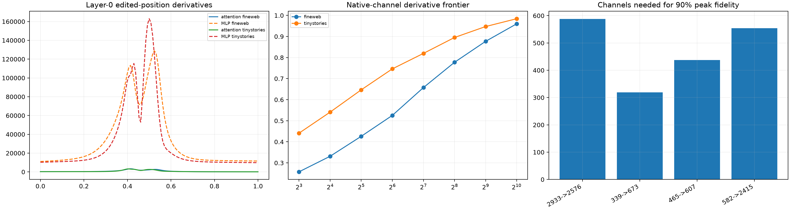

# Layer-0 bilinear-MLP path behind the his→her key-routing spike

The edited token's layer-0 update is differentiated into direct embedding, attention, and bilinear-MLP paths. The MLP derivative is split exactly into left-factor and right-factor product rules and into native post-product channel writes. Matched gender substitutions provide controls for curvature and channel count.

## Locked hypotheses

- **M1_layer0_mlp_derivative_is_unusually_sharp: supported.**
- **M2_the_mlp_dominates_the_sharp_layer0_update: supported.**
- **M3_both_bilinear_sides_matter_at_the_peak: supported.**
- **M4_the_pre_mlp_state_does_not_collapse: supported.**
- **M5_sixtyfour_native_channels_are_sufficient_for_the_peak_mlp_derivative: not supported.**
- **M6_the_peak_mlp_derivative_is_not_single_neuron_aligned: supported.**
- **M7_the_same_native_channels_recur_across_corpora: not supported.**
- **M8_dense_channel_integrals_recompose_the_finite_mlp_change: supported.**
- **M9_the_mlp_is_a_major_finite_layer0_component: supported.**
- **M10_controls_require_no_more_channels_than_the_anomaly: not supported.**

| Corpus | Pair | MLP peak ratio | MLP component share | Left/right share | Channels to 90% | Top-64 fidelity | Finite MLP projection |
|---|---|---:|---:|---:|---:|---:|---:|
| fineweb | 339->673 | 1.23 | 0.973 | 0.464/0.536 | 320 | 0.712 | 0.988 |
| fineweb | 465->607 | 8.56 | 0.978 | 0.467/0.533 | 605 | 0.525 | 0.992 |
| fineweb | 582->2415 | 1.06 | 0.969 | 0.482/0.518 | 521 | 0.574 | 0.989 |
| fineweb | 2933->2576 | 1.01 | 0.966 | 0.517/0.483 | 560 | 0.547 | 0.992 |
| tinystories | 339->673 | 1.10 | 0.974 | 0.476/0.524 | 318 | 0.721 | 0.989 |
| tinystories | 465->607 | 13.60 | 0.983 | 0.488/0.512 | 270 | 0.746 | 0.990 |
| tinystories | 582->2415 | 1.05 | 0.969 | 0.487/0.513 | 588 | 0.545 | 0.989 |
| tinystories | 2933->2576 | 1.01 | 0.967 | 0.506/0.494 | 615 | 0.521 | 0.992 |

Anomalous top-64 channel Jaccard across corpora: **0.231**. Channel counts describe causal reconstruction of the local MLP derivative, not semantic purity of those channels.
