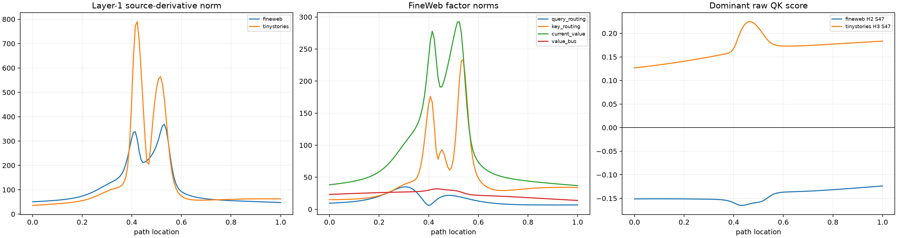

# QKOV path factorization of the layer-1 his→her transition

The sharp layer-1 source derivative is decomposed analytically into final-query routing, per-source key routing, current-layer values, and the persistent layer-0 value bus. Squared-score normalization derivatives are included exactly. Each factor is integrated over the dense token path and inserted into the native layer-1 attention write before the nonlinear suffix is recomputed.

## Locked hypotheses

- **Q1_qk_and_value_factors_recompose_the_source_derivative: supported.**
- **Q2_query_routing_dominates_the_sharp_peak: not supported.**
- **Q3_one_native_head_dominates_peak_routing: supported.**
- **Q4_one_source_edge_dominates_within_the_top_head: supported.**
- **Q5_the_same_head_recurs_across_corpora: not supported.**
- **Q6_the_same_source_position_recurs_across_corpora: supported.**
- **Q7_persistent_bus_values_dominate_current_values: not supported.**
- **Q8_the_dominant_qk_score_crosses_zero_near_the_peak: not supported.**
- **Q9_query_routing_has_a_large_integrated_causal_role: not supported.**
- **Q10_dense_qkov_factors_recover_the_finite_attention_effect: supported.**

| Corpus | Peak | Q/K routing share | Current/bus value share | Dominant head/share | Dominant source/share | Q / K / current / bus projection | Sum fidelity |
|---|---:|---:|---:|---:|---:|---:|---:|
| fineweb | 0.531 | 0.075/0.925 | 0.911/0.089 | H2 / 0.570 | S47 / 0.549 | 0.074 / 0.021 / 0.709 / 0.195 | 1.000 |
| tinystories | 0.422 | 0.009/0.991 | 0.899/0.101 | H3 / 0.768 | S47 / 0.555 | 0.030 / 0.584 / 0.227 / 0.159 | 1.000 |

The decomposition is path-local: it explains how this finite replacement traverses native QKOV factors. Stable head recurrence would support a reusable operator; changing dominant sources would instead support context-dependent instantiation of that operator.
