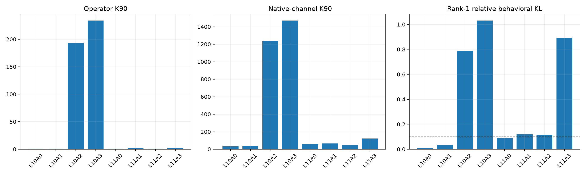

# Late address-program audit

The all-layer sweep found a compact local-operator phase at Layers 10–11. This audit reconstructs those programs on a separate covariance slice, tests token-level explanations across three corpora, and compares exact finite MLP-input edits with full-linear, rank-one, and native-channel approximations.

## Locked hypotheses

- **L1_late_compactness_replicates: not supported.**
- **L2_compact_addresses_beat_random_directions: not supported.**
- **L3_full_linearization_predicts_small_edits: supported.**
- **L4_rank1_predicts_compact_address_edits: not supported.**
- **L5_top128_native_channels_predict_compact_edits: not supported.**
- **L6_compact_programs_have_recurrent_simple_input_semantics: supported.**
- **L7_rank1_behavior_degrades_at_finite_scale: not supported.**
- **L8_final_layer_is_more_rank1_behavioral: supported.**

| Program | Operator K90 | Channel K90 | Output role | Recurrent features | Rank1 rel. KL @0.25 | Top128 rel. KL @0.25 |
|---|---:|---:|---:|---|---:|---:|
| L10A0 | 1 | 34 | 0.002 | current/newline/negative, next/word_continuation/negative | 0.009 | 0.002 |
| L10A1 | 1 | 36 | 0.001 | current/newline/negative, next/word_continuation/negative | 0.035 | 0.006 |
| L10A2 | 193 | 1235 | 0.049 | current/newline/negative, next/word_continuation/negative | 0.786 | 0.525 |
| L10A3 | 234 | 1470 | 0.028 | next/comma_period/negative | 1.031 | 0.561 |
| L11A0 | 1 | 60 | 0.090 | current/newline/negative, next/word_continuation/negative | 0.087 | 0.014 |
| L11A1 | 2 | 65 | 0.059 | current/newline/positive | 0.119 | 0.015 |
| L11A2 | 1 | 48 | 0.080 | current/newline/positive, next/word_continuation/positive | 0.114 | 0.016 |
| L11A3 | 2 | 122 | 0.032 | current/newline/negative, next/word_continuation/negative | 0.893 | 0.151 |

Low operator rank proves a short basis-invariant local map. Low relative behavioral KL shows that the short map predicts a finite downstream consequence. Native-channel prefixes answer a different question: whether the model's own coordinates give a short implementation. Recurrent token features are descriptive candidates only until an input intervention validates them.
