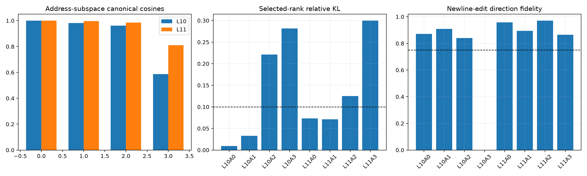

# Late-program rank and semantic red team

This follow-up tests whether the compact late programs are stable across covariance samples, whether the appropriate rank rather than rank one predicts behavior, whether larger native prefixes close the gap, and whether observational newline features survive literal input edits.

## Locked hypotheses

- **R1_layer11_address_subspace_is_stable: not supported.**
- **R2_layer10_address_subspace_is_less_stable: supported.**
- **R3_k90_rank_predicts_compact_edits: not supported.**
- **R4_rank4_predicts_all_layer11_edits: not supported.**
- **R5_top256_native_channels_predict_all_layer11_edits: not supported.**
- **R6_observational_boundary_features_survive_token_edits: supported.**
- **R7_rank_frontier_is_scale_stable: supported.**
- **R8_layer11_compactness_is_slice_stable: supported.**

Layer-10 canonical cosines: `[1.0, 0.981, 0.962, 0.587]`; Layer-11: `[1.0, 0.996, 0.985, 0.81]`.

| Program | K90 | Reported rank | Selected-rank rel. KL @0.25 | Rank4 rel. KL | Top256 rel. KL | Newline-edit fidelity |
|---|---:|---:|---:|---:|---:|---:|
| L10A0 | 1 | 1 | 0.009 | 0.004 | 0.001 | 0.871 |
| L10A1 | 1 | 1 | 0.033 | 0.011 | 0.005 | 0.909 |
| L10A2 | 193 | 64 | 0.221 | 0.589 | 0.346 | 0.840 |
| L10A3 | 234 | 64 | 0.282 | 0.835 | 0.447 | n/a |
| L11A0 | 1 | 1 | 0.073 | 0.035 | 0.007 | 0.957 |
| L11A1 | 2 | 2 | 0.071 | 0.038 | 0.009 | 0.894 |
| L11A2 | 1 | 1 | 0.125 | 0.027 | 0.009 | 0.970 |
| L11A3 | 2 | 2 | 0.300 | 0.220 | 0.087 | 0.865 |

Canonical subspace stability tests whether the explanatory address family is reproducible even if individual axes rotate. Rank-K90 tests the operator in its intrinsic basis; native prefixes test the model's own neuron coordinates. Literal token replacement is stronger than observational AUROC, although it remains a nonminimal intervention because changing a token also changes its contextual state.
