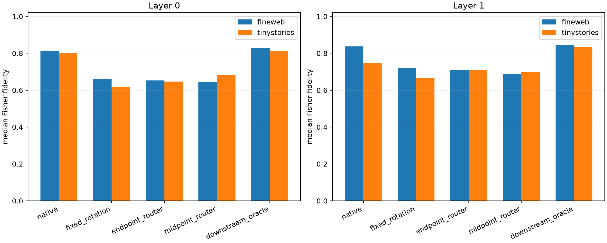

# Prospective adaptive chart router for Layer-0/1 edits

Seven random rotated product bases form an adaptive dictionary. The endpoint-local router chooses a basis using only residual-write reconstruction at the edited MLP boundary. The prospective router instead contracts the exact tensor prefix once at the embedding midpoint, ranks 256 coordinates per basis from that JVP, and chooses the basis with the best tangent-write reconstruction. Neither router sees suffix logits or downstream fidelity. Actual finite product deltas are inserted only after support and basis choice are frozen.

## Locked hypotheses

- **A0_midpoint_jvp_is_numerically_correct: not supported.**
- **A1_exact_local_router_recovers_the_downstream_oracle: not supported.**
- **A2_midpoint_router_tracks_the_exact_local_router: supported.**
- **A3_midpoint_adaptive_dictionary_beats_native: not supported.**
- **A4_midpoint_router_closes_half_the_adaptive_oracle_gap: not supported.**
- **A5_native_wins_when_it_is_a_router_candidate: supported.**
- **A6_adaptive_rotation_is_not_a_sparse_native_intervention: supported.**
- **A7_router_behavior_transfers_ood: not supported.**

| Layer | Corpus | Native / fixed rotation / endpoint router / midpoint router / downstream oracle | Midpoint−native pair median (95% CI) | Endpoint↔oracle / midpoint↔endpoint agreement | Native chosen among all charts | Rotated patch native density |
|---:|---|---:|---:|---:|---:|---:|
| 0 | fineweb | 0.814/0.662/0.652/0.644/0.829 | -0.158 (-0.255, -0.074) | 0.157/0.725 | 1.000 | 1.000 (min 0.999) |
| 0 | tinystories | 0.800/0.620/0.647/0.683/0.813 | -0.081 (-0.162, -0.008) | 0.078/0.627 | 0.980 | 1.000 (min 0.998) |
| 1 | fineweb | 0.837/0.721/0.710/0.688/0.844 | -0.112 (-0.167, -0.054) | 0.059/0.608 | 0.980 | 1.000 (min 0.998) |
| 1 | tinystories | 0.746/0.667/0.710/0.699/0.835 | -0.105 (-0.175, -0.004) | 0.216/0.608 | 1.000 | 1.000 (min 0.998) |

The rotated rank-256 program is sparse only in its chosen chart. After inverse rotation it generally changes most native product coordinates, so it is an effect-compression device rather than a literal sparse-neuron circuit. The native program remains the appropriate object for independently ablatable neuron interventions; an adaptive chart is useful only if its router predicts held-out effects well enough to justify the added dictionary and routing description.
