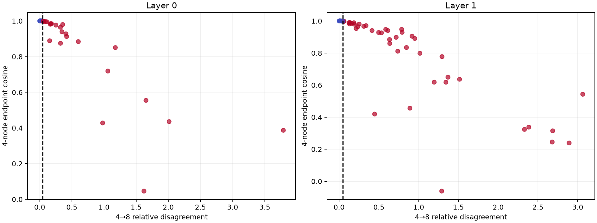

# Adaptive path quadrature on FineWeb

Four- and eight-node interior Gauss estimates are compared prospectively. Paths exceeding the locked disagreement threshold are routed to sixteen nodes; endpoint vectors remain held out until the routing decision is frozen.

## Locked hypotheses

- **A0_internal_disagreement_detects_bad_four_node_paths: supported.**
- **A1_eight_nodes_are_typically_accurate: supported.**
- **A2_sixteen_nodes_resolve_flagged_paths: supported.**
- **A3_adaptive_continuous_compiler_preserves_fineweb_behavior: not supported.**
- **A4_adaptive_support_is_compact_and_behavioral: not supported.**
- **A5_internal_confidence_separates_errors: not supported.**
- **A6_adaptation_is_prospective: supported.**

| Layer | Flagged/bad4/recall | Cosine 4/8/16 | Norm error 4/8/16 | KL 4/8/16/adaptive | Adaptive rank/endpoint rank | Stable/flagged median |
|---:|---:|---:|---:|---:|---:|---:|
| 0 | 24/10/1.000 | 1.000/1.000/1.000 | 0.007/0.000/0.000 | -1.154/0.806/0.998/0.998 | 0.800/0.813 | 1.000/1.000 |
| 1 | 42/21/1.000 | 0.969/0.995/1.000 | 0.045/0.008/0.001 | -0.876/0.242/0.582/0.582 | 0.854/0.861 | 1.000/0.991 |
