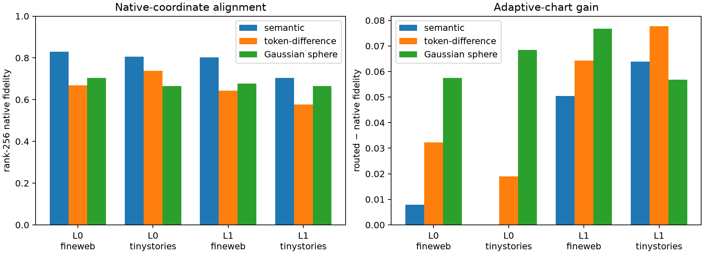

# Empirical token-difference direction control

Each natural lexical edit is compared with two random directions sampled from actual vocabulary-token differences. The random direction is transported to the natural source embedding and converted into an endpoint with exactly the same spherical chord length. This preserves empirical embedding anisotropy while removing the declared semantic relation. The native-plus-seven-chart router and all downstream measurements are unchanged.

## Locked hypotheses

- **E0_empirical_direction_chord_is_exact: supported.**
- **E1_token_difference_anisotropy_explains_native_alignment: not supported.**
- **E2_semantic_relation_alignment_exceeds_generic_token_directions: not supported.**
- **E3_chart_gain_is_specific_beyond_empirical_directions: not supported.**
- **E4_empirical_directions_also_benefit_from_chart_routing: not supported.**
- **E5_semantic_edits_prefer_native_over_empirical_directions: not supported.**
- **E6_selection_is_strictly_prospective: supported.**

| Layer | Corpus | Native fidelity semantic / empirical / sphere | Routed gain semantic / empirical / sphere | Empirical−sphere native pair median (95% CI) | Semantic−empirical native pair median (95% CI) | Native choice semantic / empirical / sphere |
|---:|---|---:|---:|---:|---:|---:|
| 0 | fineweb | 0.829 / 0.668 / 0.705 | +0.008 / +0.032 / +0.058 | -0.067 (-0.186, +0.041) | +0.141 (+0.056, +0.211) | 0.451 / 0.402 / 0.422 |
| 0 | tinystories | 0.806 / 0.737 / 0.664 | +0.000 / +0.019 / +0.068 | +0.009 (-0.046, +0.169) | +0.050 (-0.042, +0.142) | 0.471 / 0.441 / 0.333 |
| 1 | fineweb | 0.803 / 0.642 / 0.676 | +0.050 / +0.064 / +0.077 | -0.099 (-0.137, +0.098) | +0.090 (+0.006, +0.169) | 0.333 / 0.265 / 0.343 |
| 1 | tinystories | 0.705 / 0.577 / 0.664 | +0.064 / +0.078 / +0.057 | -0.083 (-0.189, +0.046) | +0.111 (+0.035, +0.283) | 0.294 / 0.353 / 0.284 |

## Example random direction sources

These token pairs determine only the transported direction; neither token is inserted into the evaluated context.

| Semantic pair | Random token difference 1 | Random token difference 2 |
|---|---|---|
| `1049->7818` | `efined` → ` swirling` | `rame` → ` Scandinav` |
| `1049->7818` | ` agon` → ` levy` | ` Dong` → `asi` |
| `1049->7818` | ` depending` → ` adul` | ` Drop` → ` married` |
| `3621->1612` | `Bull` → ` Promise` | ` bins` → ` illness` |
| `3621->1612` | ` favorites` → ` posted` | `acting` → `Training` |
| `3621->1612` | ` transparency` → ` Fut` | `hews` → ` apocalyptic` |

Maximum relative chord-distance mismatch: **1.18e-07**. Maximum relative sphere-radius mismatch: **1.38e-07**.

This control distinguishes generic anisotropy of learned token-difference directions from specificity to the intended lexical relation. It does not turn the transported endpoint into a real vocabulary embedding, so a remaining semantic advantage could still reflect the discrete token manifold rather than human-interpretable semantics.
