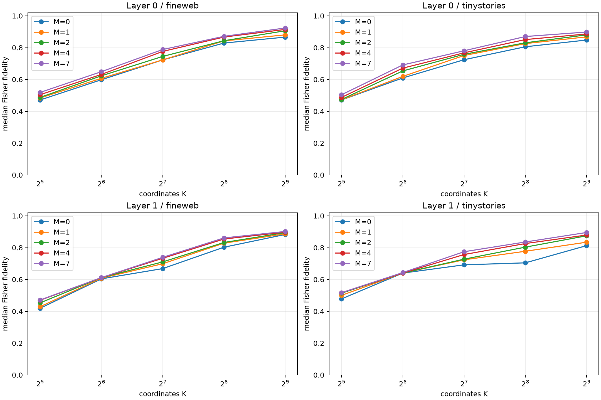

# Rank-versus-chart-bank frontier

Native plus random rotated product charts are routed using the midpoint suffix-Fisher contraction. All subsets of sizes 1, 2, and 4 from the seven rotations are enumerated; size 0 is native-only and size 7 is the complete bank. Finite effects are inspected only after chart choice is frozen.

## Locked hypotheses

- **P0_suffix_router_stays_near_the_subset_oracle: not supported.**
- **P1_two_rotation_atlas_captures_most_of_the_gain: not supported.**
- **P2_seven_charts_halve_the_coordinate_budget: not supported.**
- **P3_seven_charts_quarter_the_coordinate_budget: not supported.**
- **P4_returns_diminish_after_four_rotations: supported.**
- **P5_chart_subset_choice_is_robust: supported.**
- **P6_adaptive_chart_gain_increases_with_depth: not supported.**
- **P7_chart_gain_transfers_ood: supported.**
- **P8_router_never_needs_endpoint_outcomes: supported.**

| Layer | Corpus | Rank | Native / median M1 / M2 / M4 / M7 routed fidelity | M7−native pair median (95% CI) | M2/M4 subset ranges |
|---:|---|---:|---:|---:|---:|
| 0 | fineweb | 32 | 0.471/0.484/0.488/0.505/0.519 | +0.000 (+0.000, +0.126) | 0.025/0.034 |
| 0 | fineweb | 64 | 0.598/0.607/0.623/0.632/0.649 | +0.000 (+0.000, +0.064) | 0.033/0.051 |
| 0 | fineweb | 128 | 0.723/0.723/0.745/0.776/0.788 | +0.000 (+0.000, +0.118) | 0.022/0.041 |
| 0 | fineweb | 256 | 0.829/0.843/0.843/0.867/0.871 | +0.000 (+0.000, +0.033) | 0.038/0.041 |
| 0 | fineweb | 512 | 0.866/0.880/0.906/0.914/0.923 | +0.016 (+0.000, +0.047) | 0.020/0.012 |
| 0 | tinystories | 32 | 0.471/0.472/0.475/0.487/0.504 | +0.000 (+0.000, +0.000) | 0.015/0.020 |
| 0 | tinystories | 64 | 0.610/0.619/0.654/0.671/0.691 | +0.000 (+0.000, +0.000) | 0.056/0.038 |
| 0 | tinystories | 128 | 0.724/0.751/0.758/0.768/0.781 | +0.000 (+0.000, +0.095) | 0.022/0.024 |
| 0 | tinystories | 256 | 0.806/0.825/0.831/0.851/0.870 | +0.000 (+0.000, +0.141) | 0.038/0.045 |
| 0 | tinystories | 512 | 0.848/0.868/0.880/0.886/0.898 | +0.044 (+0.003, +0.085) | 0.035/0.028 |
| 1 | fineweb | 32 | 0.419/0.429/0.453/0.470/0.471 | +0.000 (+0.000, +0.175) | 0.029/0.029 |
| 1 | fineweb | 64 | 0.604/0.608/0.612/0.612/0.612 | +0.017 (+0.000, +0.101) | 0.008/0.011 |
| 1 | fineweb | 128 | 0.668/0.699/0.710/0.733/0.739 | +0.000 (+0.000, +0.204) | 0.034/0.029 |
| 1 | fineweb | 256 | 0.803/0.828/0.832/0.854/0.861 | +0.022 (+0.000, +0.160) | 0.031/0.025 |
| 1 | fineweb | 512 | 0.883/0.887/0.894/0.897/0.902 | +0.025 (+0.000, +0.058) | 0.024/0.017 |
| 1 | tinystories | 32 | 0.478/0.500/0.514/0.517/0.517 | +0.000 (+0.000, +0.149) | 0.024/0.017 |
| 1 | tinystories | 64 | 0.640/0.640/0.640/0.640/0.644 | +0.000 (+0.000, +0.093) | 0.047/0.031 |
| 1 | tinystories | 128 | 0.692/0.724/0.728/0.757/0.774 | +0.000 (+0.000, +0.000) | 0.034/0.047 |
| 1 | tinystories | 256 | 0.705/0.777/0.803/0.826/0.836 | +0.044 (+0.000, +0.135) | 0.039/0.018 |
| 1 | tinystories | 512 | 0.813/0.834/0.874/0.879/0.895 | +0.035 (+0.000, +0.111) | 0.061/0.033 |

Complexity is reported in separate currencies: rank K is the per-example coordinate payload, `ceil(log2(1+M))` bits identify one of native plus M rotated charts, and the router evaluates 1+M suffix contractions. Stored chart definitions are an additional global cost and are not hidden inside K. A rotated payload remains dense in native coordinates.
