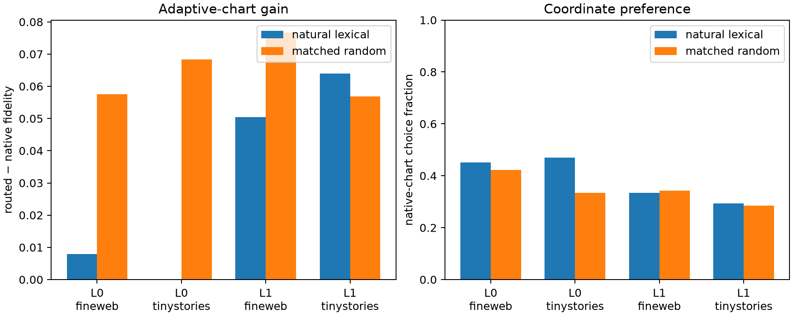

# Semantic specificity of adaptive effect charts

Every natural source→target token edit is paired with two random endpoints on the normalized embedding sphere at exactly the same chord distance. Natural and synthetic edits use the same source context, rank-256 native-plus-seven chart bank, midpoint product JVP, exact suffix JVP, and Fisher output metric. Chart selection is prospective; finite endpoint effects are inspected only after the choice is frozen.

## Locked hypotheses

- **S0_synthetic_chord_distance_is_exact: supported.**
- **S1_chart_gain_is_semantically_specific: not supported.**
- **S2_synthetic_directions_also_benefit_from_chart_routing: supported.**
- **S3_synthetic_router_tracks_the_finite_chart_oracle: supported.**
- **S4_natural_edits_prefer_native_coordinates: not supported.**
- **S5_selection_is_strictly_prospective: supported.**

| Layer | Corpus | Semantic native/routed/oracle/gain | Synthetic native/routed/oracle/gain | Semantic−synthetic gain pair median (95% CI) | Native choice semantic/synthetic |
|---:|---|---:|---:|---:|---:|
| 0 | fineweb | 0.829/0.871/0.883/+0.008 | 0.705/0.802/0.808/+0.058 | +0.000 (-0.082, +0.014) | 0.451/0.422 |
| 0 | tinystories | 0.806/0.870/0.873/+0.000 | 0.664/0.788/0.842/+0.068 | -0.006 (-0.089, +0.047) | 0.471/0.333 |
| 1 | fineweb | 0.803/0.861/0.870/+0.050 | 0.676/0.788/0.816/+0.077 | +0.021 (-0.081, +0.066) | 0.333/0.343 |
| 1 | tinystories | 0.705/0.836/0.842/+0.064 | 0.664/0.740/0.790/+0.057 | +0.000 (-0.057, +0.107) | 0.294/0.284 |

Maximum relative chord-distance mismatch: **1.23e-07**. Maximum relative sphere-radius mismatch: **6.88e-08**.

If synthetic endpoints obtain the same chart gain as natural edits, the atlas is best treated as a generic output-conditioned approximation scheme rather than evidence for semantic coordinates. A natural-edit advantage would instead show that the model's learned manifold is unusually compatible with the available charts; it would still not make rotated coordinates literal independently ablatable neurons.
