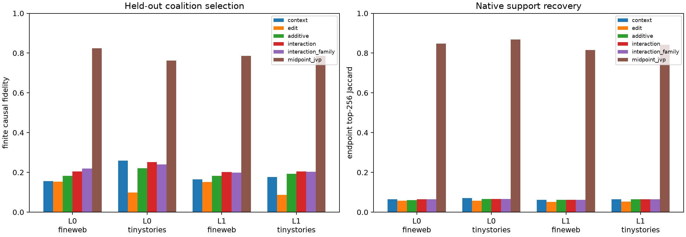

# Conditional native-coalition selector decomposition

Ridge selectors are trained only on the old FineWeb lexical pairs and evaluated on seventeen disjoint pairs in FineWeb and TinyStories. Their target is the normalized midpoint product tangent. Context-only, edit-only, additive, context×edit random-feature, and family-label variants all choose 256 native channels; only the selected channels' exact finite endpoint deltas are then patched through the complete suffix. Exact base/midpoint JVPs and endpoint-informed selection are mechanistic references, not learned models.

## Locked hypotheses

- **C0_pair_splits_and_numerics_are_valid: supported.**
- **C1_context_edit_interaction_beats_additive_selection: not supported.**
- **C2_human_family_labels_improve_the_interaction_selector: not supported.**
- **C3_conditional_selection_beats_one_sided_selection: not supported.**
- **C4_conditional_selection_is_useful_on_held_out_pairs: not supported.**
- **C5_exact_tensor_contraction_retains_a_material_advantage: supported.**
- **C6_fixed_family_banks_remain_weak: supported.**
- **C7_interaction_success_is_not_a_shuffled_target_artifact: not supported.**
- **C8_conditional_selector_transfers_out_of_distribution: supported.**
- **C9_exact_midpoint_reference_replicates: supported.**
- **C10_endpoint_oracle_is_high_fidelity: not supported.**

| Layer | Corpus | Context / edit / additive / interaction / +family fidelity | Family/global bank | Shuffled / midpoint / endpoint | Interaction support / cosine | Interaction−additive pair median (95% CI) |
|---:|---|---:|---:|---:|---:|---:|
| 0 | fineweb | 0.156 / 0.153 / 0.182 / 0.204 / 0.219 | 0.153 / 0.117 | 0.123 / 0.824 / 0.795 | 0.064 / 0.045 | -0.006 (-0.058, +0.051) |
| 0 | tinystories | 0.259 / 0.098 / 0.221 / 0.252 / 0.240 | 0.119 / 0.171 | 0.162 / 0.762 / 0.734 | 0.067 / 0.058 | +0.024 (-0.070, +0.095) |
| 1 | fineweb | 0.165 / 0.151 / 0.183 / 0.202 / 0.199 | 0.124 / 0.169 | 0.146 / 0.787 / 0.757 | 0.062 / 0.018 | +0.039 (-0.020, +0.100) |
| 1 | tinystories | 0.176 / 0.087 / 0.192 / 0.204 / 0.203 | 0.100 / 0.170 | 0.127 / 0.786 / 0.813 | 0.064 / 0.009 | -0.008 (-0.022, +0.023) |

## Selected ridge penalties

| Layer | context | edit | additive | additive_family | interaction | interaction_family |
|---:|---:|---:|---:|---:|---:|---:|
| 0 | 1.0 | 0.01 | 1.0 | 1.0 | 1.0 | 1.0 |
| 1 | 10.0 | 10.0 | 1.0 | 1.0 | 1.0 | 1.0 |

Selection fidelity is the causal metric: predicted vectors are used only to choose native coordinates, after which the true finite deltas on those coordinates are inserted. Midpoint cosine measures predictor geometry but cannot by itself establish a useful circuit. The learned predictors are restricted to the span supported by discovery examples; failure does not imply that no more expressive weight-aware compiler exists—the exact tensor JVP is such a compiler.
