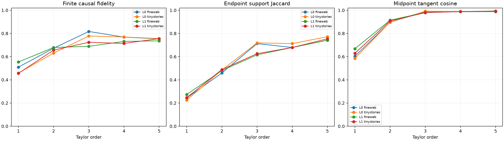

# Directional-derivative order frontier

The base-point tensor program is expanded through fifth directional order. For order `n`, midpoint-derivative coefficients are `0.5^(n-1)/(n-1)!`; endpoint-integral coefficients are `1/n!`. Every selector is frozen before explicit midpoint and endpoint outcomes are evaluated, and selected coordinates are scored using their exact finite deltas through the full suffix.

## Locked hypotheses

- **O0_all_directional_orders_are_numerically_valid: supported.**
- **O1_midpoint_direction_converges_monotonically: supported.**
- **O2_fourth_order_improves_cubic_causal_selection: not supported.**
- **O3_fifth_order_improves_fourth_order_selection: not supported.**
- **O4_some_base_point_order_matches_the_explicit_midpoint: supported.**
- **O5_fifth_order_is_high_fidelity: supported.**
- **O6_fifth_order_recovers_three_quarters_of_endpoint_support: not supported.**
- **O7_returns_diminish_after_fourth_order: not supported.**
- **O8_integral_and_midpoint_series_select_similar_circuits: not supported.**
- **O9_order_frontier_transfers_out_of_distribution: supported.**
- **O10_no_interior_or_endpoint_outcome_is_used: supported.**

| Layer | Corpus | Midpoint order 1/2/3/4/5 fidelity | Explicit midpoint | Order 1/2/3/4/5 support | Order 1/2/3/4/5 cosine | Best order/fidelity |
|---:|---|---:|---:|---:|---:|---:|
| 0 | fineweb | 0.509/0.672/0.817/0.768/0.753 | 0.812 | 0.243/0.459/0.712/0.679/0.741 | 0.604/0.897/0.989/0.987/0.988 | 3/0.817 |
| 0 | tinystories | 0.458/0.631/0.778/0.769/0.756 | 0.768 | 0.225/0.484/0.718/0.712/0.772 | 0.585/0.897/0.991/0.989/0.990 | 3/0.778 |
| 1 | fineweb | 0.554/0.679/0.689/0.731/0.736 | 0.761 | 0.274/0.480/0.615/0.679/0.741 | 0.669/0.914/0.981/0.988/0.993 | 5/0.736 |
| 1 | tinystories | 0.456/0.656/0.723/0.714/0.755 | 0.742 | 0.246/0.488/0.625/0.679/0.753 | 0.629/0.908/0.979/0.989/0.991 | 5/0.755 |

## Scaled derivative-term norms and numerical controls

| Layer | Corpus | Scaled term norms 1/2/3/4/5 | Max finite-difference errors 1/2/3/4/5 |
|---:|---|---:|---:|
| 0 | fineweb | 0.791/0.707/0.506/0.352/0.222 | 0.002/0.000/0.001/0.001/0.001 |
| 0 | tinystories | 0.810/0.742/0.512/0.368/0.211 | 0.003/0.000/0.001/0.001/0.001 |
| 1 | fineweb | 0.829/0.658/0.456/0.270/0.154 | 0.003/0.000/0.001/0.001/0.003 |
| 1 | tinystories | 0.828/0.699/0.452/0.275/0.175 | 0.003/0.000/0.001/0.003/0.008 |

A convergent direction frontier would give a compact weight-only compiler whose complexity is derivative order rather than a learned semantic dictionary. Oscillation or late-order degradation would instead identify a local-radius limit: the exact midpoint remains simple to evaluate, but not reducible to a short base-point series.
