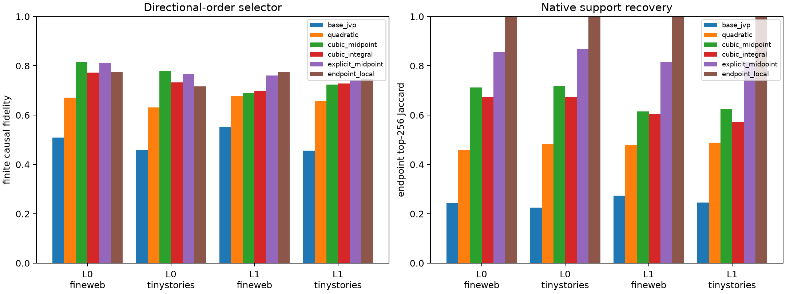

# Directional Taylor compilation of native coalitions

At the original normalized embedding state, nested forward-mode contractions compute the first three directional derivatives of the exact prefix-to-MLP-product map along each declared token edit. Rank-256 selectors use `Jd`, `Jd + 1/2 H[d,d]`, and cubic variants before any midpoint or finite endpoint outcome is evaluated. Their selected coordinates are scored causally by inserting only the corresponding exact finite product deltas through the full suffix.

## Locked hypotheses

- **T0_nested_directional_derivatives_are_numerically_valid: supported.**
- **T1_quadratic_taylor_selection_beats_the_base_jvp: not supported.**
- **T2_cubic_taylor_selection_beats_quadratic_selection: not supported.**
- **T3_cubic_taylor_selection_matches_explicit_midpoint_selection: not supported.**
- **T4_cubic_taylor_selection_is_high_fidelity: not supported.**
- **T5_cubic_taylor_recovers_native_support: supported.**
- **T6_integral_coefficient_improves_endpoint_selection: not supported.**
- **T7_cubic_selector_transfers_out_of_distribution: supported.**
- **T8_endpoint_local_reference_is_adequate: supported.**
- **T9_no_midpoint_or_endpoint_outcome_is_used_by_taylor_selectors: supported.**

| Layer | Corpus | Base / quadratic / cubic-mid / cubic-integral / explicit-mid / endpoint fidelity | Cubic support / midpoint cosine | Quadratic−base pair median (95% CI) | Cubic−quadratic pair median (95% CI) |
|---:|---|---:|---:|---:|---:|
| 0 | fineweb | 0.509 / 0.672 / 0.817 / 0.773 / 0.811 / 0.776 | 0.712 / 0.989 | +0.105 (+0.068, +0.178) | +0.058 (-0.013, +0.180) |
| 0 | tinystories | 0.458 / 0.631 / 0.778 / 0.732 / 0.768 / 0.716 | 0.718 / 0.991 | +0.142 (+0.065, +0.252) | +0.100 (+0.013, +0.160) |
| 1 | fineweb | 0.554 / 0.679 / 0.689 / 0.699 / 0.761 / 0.774 | 0.615 / 0.981 | +0.049 (+0.018, +0.097) | +0.031 (-0.015, +0.107) |
| 1 | tinystories | 0.456 / 0.656 / 0.724 / 0.729 / 0.741 / 0.747 | 0.625 / 0.979 | +0.042 (-0.005, +0.117) | +0.099 (+0.046, +0.161) |

## Numerical derivative controls

| Layer | Corpus | First min cosine/max error | Second | Third |
|---:|---|---:|---:|---:|
| 0 | fineweb | 1.00000/0.002 | 1.00000/0.000 | 1.00000/0.001 |
| 0 | tinystories | 0.99999/0.003 | 1.00000/0.000 | 1.00000/0.001 |
| 1 | fineweb | 1.00000/0.003 | 1.00000/0.000 | 1.00000/0.001 |
| 1 | tinystories | 0.99999/0.003 | 1.00000/0.000 | 1.00000/0.001 |

The Taylor selectors are weight-derived compilers, not semantic probes: they know the exact base state and proposed input edit. Success would establish a short local algebraic description of coalition selection. Failure can arise from a limited convergence radius even when the explicit midpoint contraction succeeds; derivative norms and finite-difference controls are retained to distinguish numerical bugs from genuine high curvature.
