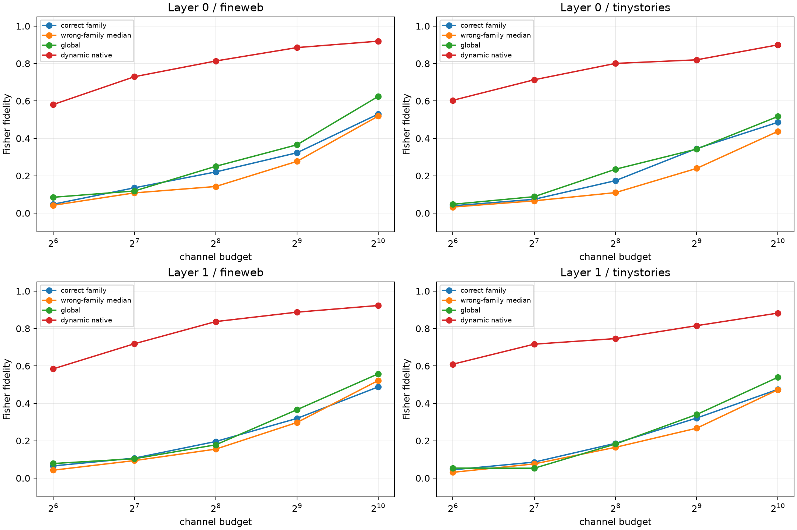

# Rotation and discovery-data red-team of Layer-0/1 dynamic alignment

Seven independently randomized dense orthogonal coordinate systems are compared with the native bilinear basis at rank 256. Frozen semantic banks are refit from eight rather than two discovery contexts per old lexical pair and swept from rank 64 to 1,024. Evaluation remains on the seventeen untouched lexical pairs in FineWeb and TinyStories.

## Locked hypotheses

- **M0_rotation_round_trips_are_exact: supported.**
- **M1_native_privilege_survives_multiple_rotations: not supported.**
- **M2_more_discovery_data_rescues_a_fixed_semantic_code: not supported.**
- **M3_any_fixed_family_label_signal_is_universal: not supported.**
- **M4_family_banks_beat_generic_banks: not supported.**
- **M5_fixed_banks_remain_weaker_than_dynamic_selection: supported.**
- **M6_two_context_failure_was_not_just_estimation_noise: supported.**
- **M7_family_bank_support_is_reproducible: not supported.**

| Layer | Corpus | Native / best rotation | Native-best pair median (95% CI) | Bank rank 64/128/256/512/1024 correct | Corresponding wrong | Corresponding global |
|---:|---|---:|---:|---:|---:|---:|
| 0 | fineweb | 0.814/0.829 | -0.002 (-0.068, +0.028) | 0.048/0.136/0.220/0.323/0.530 | 0.042/0.108/0.143/0.277/0.519 | 0.085/0.119/0.250/0.366/0.624 |
| 0 | tinystories | 0.801/0.814 | -0.006 (-0.155, +0.024) | 0.039/0.074/0.174/0.345/0.486 | 0.033/0.066/0.110/0.239/0.438 | 0.047/0.088/0.235/0.343/0.517 |
| 1 | fineweb | 0.837/0.844 | +0.007 (-0.017, +0.023) | 0.065/0.107/0.196/0.319/0.488 | 0.043/0.094/0.155/0.298/0.522 | 0.078/0.104/0.178/0.366/0.558 |
| 1 | tinystories | 0.746/0.835 | -0.093 (-0.127, -0.022) | 0.045/0.086/0.186/0.321/0.475 | 0.031/0.076/0.165/0.267/0.473 | 0.054/0.053/0.182/0.340/0.539 |

Discovery-half rank-256 support Jaccard:

- Layer 0: median **0.172**; sentiment=0.172, gender=0.180, tense=0.180, increasing_scale=0.148, polarity=0.120
- Layer 1: median **0.125**; sentiment=0.125, gender=0.096, tense=0.158, increasing_scale=0.128, polarity=0.108

Maximum inverse-rotation relative error: **4.92e-07**.

The best-of-seven rotation is an intentionally adversarial comparator: it gives the rotated basis seven chances per example. A fixed family bank is credited only if one preregistered rank works in every layer/corpus cell; isolated positive cells are retained in the raw table but do not establish a universal semantic neuron dictionary.
