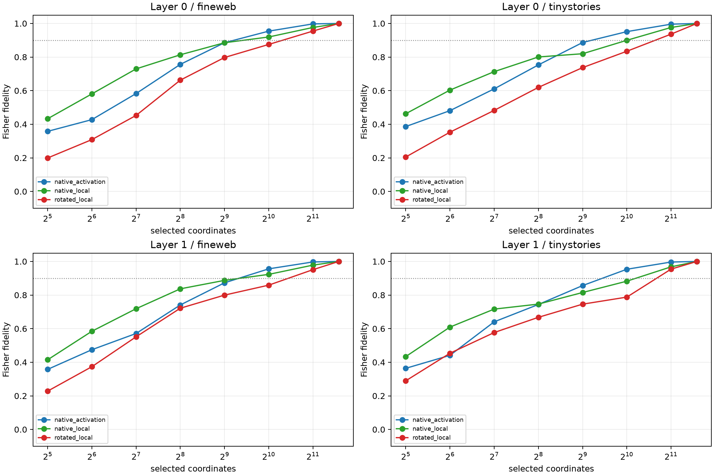

# Independent-checkpoint replication of Layer-0/1 dynamic neuron alignment

The unchanged final-query MLP assay is repeated on `Elriggs/gpt2-bilinear-sqrd-attn-12l-6h-768embd` at commit `51690b862c026c600ee0645e8dd5474f43ef3f64` (12 layers, width 768, 3,072 bilinear channels). Frozen semantic banks are learned from the old FineWeb lexical pairs; native/rotated frontiers and banks are evaluated on seventeen new lexical pairs in FineWeb and TinyStories.

## Locked hypotheses

- **R0_numerical_controls_reconstruct: supported.**
- **R1_dynamic_native_execution_is_moderately_sparse: supported.**
- **R2_native_basis_is_privileged: supported.**
- **R3_high_fidelity_native_execution_is_broad: supported.**
- **R4_fixed_semantic_banks_are_not_sufficient: supported.**
- **R5_fixed_semantic_identity_is_detectable: not supported.**
- **R6_dynamic_alignment_transfers_ood: supported.**
- **R7_qualitative_ontology_replicates: supported.**
- **R8_activation_ranking_is_state_informative: supported.**

| Layer | Corpus | Native activation S50/S90 | Native local S50/S90 | Rotated local S50/S90 | Rank-256 native/rotated (pair CI) | Correct/wrong/global bank (bank CI) |
|---:|---|---:|---:|---:|---:|---:|
| 0 | fineweb | 128/1024 | 64/1024 | 256/2048 | 0.813/0.663 (+0.069, +0.247) | 0.188/0.176/0.170 (-0.030, +0.181) |
| 0 | tinystories | 128/1024 | 64/2048 | 256/2048 | 0.800/0.620 (+0.031, +0.207) | 0.154/0.146/0.213 (-0.135, +0.144) |
| 1 | fineweb | 128/1024 | 64/1024 | 128/2048 | 0.837/0.722 (+0.062, +0.200) | 0.200/0.111/0.167 (-0.182, +0.075) |
| 1 | tinystories | 128/1024 | 64/2048 | 128/2048 | 0.746/0.667 (+0.039, +0.168) | 0.207/0.129/0.199 (-0.136, +0.113) |

Maximum inverse-rotation relative error: **4.84e-07**.

The native frontier tests execution alignment: coordinates are selected separately for each realized edit. The frozen banks test semantic identity alignment: the same discovered channel set must serve unseen lexical pairs. Passing the first while failing the second is the conditional-native-program ontology, not classical one-concept/one-neuron monosemanticity.

## Original 18-layer reference

| Layer | Corpus | Native local S50/S90 | Rotated local S50/S90 | Rank-256 advantage |
|---:|---|---:|---:|---:|
| 0 | fineweb | 128/2048 | 256/4096 | +0.091 |
| 0 | tinystories | 128/2048 | 128/2048 | +0.069 |
| 1 | fineweb | 128/2048 | 256/4096 | +0.180 |
| 1 | tinystories | 64/2048 | 256/4096 | +0.152 |
