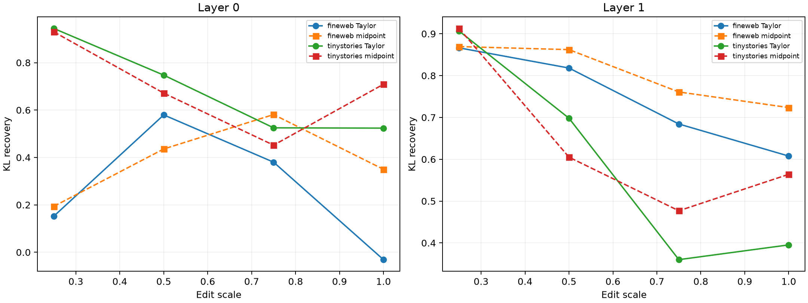

# Radius of validity for Taylor-compiled coalitions

The same naturally sampled token substitutions are continuously scaled in normalized-embedding space. Frozen Layer-0 cubic and Layer-1 fifth-order programs select 256 native product channels before the finite endpoint patch is evaluated.

## Locked hypotheses

- **S0_full_patch_recomposition_is_exact: supported.**
- **S1_taylor_direction_degrades_with_radius: supported.**
- **S2_quarter_radius_is_predictable: not supported.**
- **S3_half_radius_remains_useful: not supported.**
- **S4_large_edits_cross_a_locality_boundary: not supported.**
- **S5_exact_midpoint_rescues_large_edits: not supported.**
- **S6_truncation_is_a_material_large_edit_cost: supported.**
- **S7_taylor_beats_random_within_its_local_regime: not supported.**
- **S8_radius_frontier_transfers_ood: not supported.**
- **S9_scales_and_orders_are_frozen: supported.**

| Layer | Corpus | Scale | Chord | Taylor/explicit midpoint cosine | Taylor/explicit/endpoint/random KL recovery | Taylor support |
|---:|---|---:|---:|---:|---:|---:|
| 0 | fineweb | 0.25 | 9.56 | 1.000/0.999 | 0.152/0.194/0.326/0.245 | 0.932 |
| 0 | fineweb | 0.50 | 19.12 | 0.994/0.992 | 0.579/0.436/0.750/0.101 | 0.695 |
| 0 | fineweb | 0.75 | 28.68 | 0.936/0.958 | 0.380/0.581/0.759/0.053 | 0.428 |
| 0 | fineweb | 1.00 | 38.25 | 0.685/0.874 | -0.031/0.350/0.811/0.137 | 0.258 |
| 0 | tinystories | 0.25 | 9.63 | 1.000/0.999 | 0.944/0.930/0.919/0.010 | 0.921 |
| 0 | tinystories | 0.50 | 19.26 | 0.994/0.990 | 0.747/0.671/0.815/-0.070 | 0.690 |
| 0 | tinystories | 0.75 | 28.90 | 0.938/0.955 | 0.525/0.452/0.760/0.225 | 0.389 |
| 0 | tinystories | 1.00 | 38.53 | 0.725/0.861 | 0.524/0.709/0.845/0.131 | 0.226 |
| 1 | fineweb | 0.25 | 9.56 | 1.000/0.999 | 0.866/0.869/0.864/0.183 | 0.947 |
| 1 | fineweb | 0.50 | 19.12 | 1.000/0.988 | 0.818/0.862/0.873/0.193 | 0.772 |
| 1 | fineweb | 0.75 | 28.68 | 0.971/0.929 | 0.684/0.761/0.847/0.176 | 0.480 |
| 1 | fineweb | 1.00 | 38.25 | 0.786/0.794 | 0.608/0.724/0.835/-0.017 | 0.218 |
| 1 | tinystories | 0.25 | 9.63 | 1.000/0.999 | 0.906/0.913/0.910/0.270 | 0.939 |
| 1 | tinystories | 0.50 | 19.26 | 0.999/0.981 | 0.698/0.605/0.541/0.168 | 0.712 |
| 1 | tinystories | 0.75 | 28.90 | 0.971/0.871 | 0.360/0.477/0.681/0.073 | 0.344 |
| 1 | tinystories | 1.00 | 38.53 | 0.786/0.817 | 0.395/0.564/0.851/0.183 | 0.182 |
