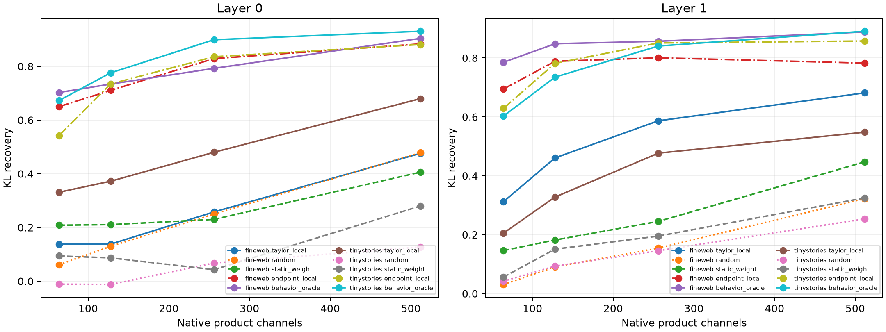

# Frozen Taylor coalitions preserve downstream behavior

Orders learned on the earlier 17-pair semantic panel are frozen (Layer 0 cubic; Layer 1 fifth order), then tested on independent natural-distribution token substitutions. Each prospective score is used only to select native product channels; the exact finite endpoint delta on those selected channels is patched through the complete suffix. KL recovery is normalized between the unpatched base (0) and the full local product patch (1).

## Locked hypotheses

- **B0_full_patch_recomposition_is_exact: supported.**
- **B1_frozen_taylor_preserves_behavior: not supported.**
- **B2_taylor_beats_unconditioned_controls: not supported.**
- **B3_taylor_approaches_endpoint_local: not supported.**
- **B4_behavioral_compiler_transfers_ood: not supported.**
- **B5_output_connectivity_matters: not supported.**
- **B6_behavior_oracle_is_an_upper_control: supported.**
- **B7_ce_effect_is_preserved: not supported.**
- **B8_high_effect_results_are_not_baseline_triviality: not supported.**
- **B9_orders_and_sampling_are_frozen: supported.**

| Layer | Corpus | Full-patch KL / top-1 changes | Taylor/random/static/endpoint-local/oracle KL recovery @256 | High-effect Taylor/random | Taylor CE-effect fidelity | Full local path recovery to endpoint |
|---:|---|---:|---:|---:|---:|---:|
| 0 | fineweb | 5.999e-05 / 0.000 | 0.258/0.250/0.230/0.829/0.792 | 0.251/0.270 | 0.202 | 0.005 |
| 0 | tinystories | 3.961e-05 / 0.000 | 0.480/0.068/0.043/0.836/0.899 | 0.496/0.058 | 0.539 | 0.001 |
| 1 | fineweb | 1.332e-04 / 0.000 | 0.587/0.154/0.245/0.800/0.857 | 0.612/0.165 | 0.367 | -0.000 |
| 1 | tinystories | 6.834e-05 / 0.000 | 0.477/0.145/0.195/0.851/0.840 | 0.491/0.157 | 0.639 | 0.004 |

Top-1 agreement is reported in the JSON but is not treated as decisive because small local effects can leave the argmax unchanged even for the unpatched baseline. The highest-effect quartile and normalized KL/CE effects are the anti-triviality checks.
