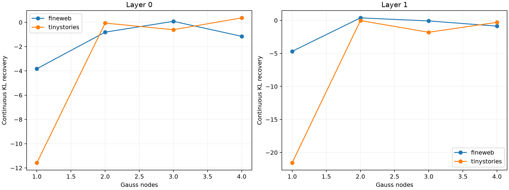

# Path-quadrature compiler

Finite product changes are predicted by Gauss–Legendre integration of exact directional JVPs at strictly interior points of the embedding edit path. Endpoint product values are held out until continuous predictions and suffix-Fisher supports are frozen.

## Locked hypotheses

- **Q0_quadrature_direction_converges: not supported.**
- **Q1_three_nodes_predict_the_finite_vector: not supported.**
- **Q2_three_node_continuous_patch_preserves_behavior: not supported.**
- **Q3_three_node_support_preserves_behavior: not supported.**
- **Q4_quadrature_repairs_midpoint_overshoot: supported.**
- **Q5_four_nodes_have_diminishing_returns: not supported.**
- **Q6_quadrature_compiler_transfers_ood: not supported.**
- **Q7_quadrature_is_prospective: supported.**

| Layer | Corpus | Cosine 1/2/3/4 | Norm ratio 1/2/3/4 | Continuous KL 1/2/3/4 | Rank actual 1/3/endpoint | Gauss3 rank predicted |
|---:|---|---:|---:|---:|---:|---:|
| 0 | fineweb | 0.852/0.917/0.994/1.000 | 1.873/0.972/1.042/0.998 | -3.822/-0.808/0.082/-1.153 | 0.675/0.756/0.813 | 0.253 |
| 0 | tinystories | 0.861/0.924/0.992/1.000 | 1.941/0.948/1.048/0.999 | -11.575/-0.062/-0.607/0.368 | 0.800/0.849/0.900 | -0.669 |
| 1 | fineweb | 0.788/0.920/0.960/0.969 | 1.860/0.993/1.047/1.018 | -4.691/0.374/-0.088/-0.876 | 0.717/0.763/0.861 | 0.032 |
| 1 | tinystories | 0.803/0.840/0.956/0.943 | 1.844/1.042/1.066/1.050 | -21.561/-0.032/-1.808/-0.300 | 0.621/0.738/0.833 | -6.946 |
