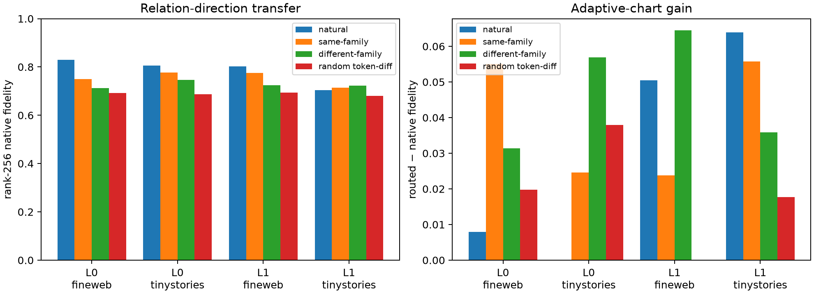

# Semantic relation-direction transfer

For each natural lexical edit, embedding differences from every other pair in the same declared semantic family are transported to the source token at the exact natural chord length. An equally sized deterministic set of different-family directions is the control. Neither donor endpoint is a vocabulary token. All native and adaptive-chart effects use the unchanged prospective suffix-Fisher assay.

## Locked hypotheses

- **D0_transported_donor_chords_are_exact: supported.**
- **D1_same_family_directions_have_privileged_native_alignment: not supported.**
- **D2_same_family_directions_beat_generic_token_differences: not supported.**
- **D3_same_family_directions_recover_the_natural_native_code: not supported.**
- **D4_same_family_directions_prefer_native_charts: not supported.**
- **D5_relation_specificity_is_not_just_adaptive_chart_gain: supported.**
- **D6_selection_is_strictly_prospective: supported.**

| Layer | Corpus | Native natural / same-family / different-family / random | Same−different native pair median (95% CI) | Natural−same native pair median (95% CI) | Gain natural / same / different / random |
|---:|---|---:|---:|---:|---:|
| 0 | fineweb | 0.829 / 0.749 / 0.713 / 0.692 | +0.024 (-0.020, +0.049) | +0.073 (-0.033, +0.193) | +0.008 / +0.055 / +0.031 / +0.020 |
| 0 | tinystories | 0.806 / 0.777 / 0.746 / 0.688 | +0.018 (-0.041, +0.075) | +0.037 (-0.045, +0.076) | +0.000 / +0.025 / +0.057 / +0.038 |
| 1 | fineweb | 0.803 / 0.775 / 0.724 / 0.693 | +0.023 (-0.040, +0.091) | +0.029 (-0.033, +0.102) | +0.050 / +0.024 / +0.065 / +0.000 |
| 1 | tinystories | 0.705 / 0.714 / 0.722 / 0.680 | -0.007 (-0.082, +0.079) | -0.004 (-0.037, +0.085) | +0.064 / +0.056 / +0.036 / +0.018 |

## Same-family minus different-family native fidelity by family

| Layer | Corpus | sentiment | gender | tense | increasing_scale | polarity |
|---:|---|---:|---:|---:|---:|---:|
| 0 | fineweb | +0.049 | +0.013 | +0.045 | +0.014 | -0.008 |
| 0 | tinystories | -0.027 | +0.046 | -0.030 | +0.093 | -0.043 |
| 1 | fineweb | -0.145 | +0.013 | +0.049 | +0.113 | +0.021 |
| 1 | tinystories | -0.074 | -0.050 | +0.012 | -0.096 | +0.103 |

Maximum relative chord-distance mismatch: **1.34e-07**. Maximum relative sphere-radius mismatch: **6.88e-08**.

Same-family transfer would be evidence for a reusable relation direction at the embedding-to-early-layer interface, not a one-neuron semantic module. Failure would leave natural native alignment as pair-specific or manifold-specific rather than family-level semantic reuse.
