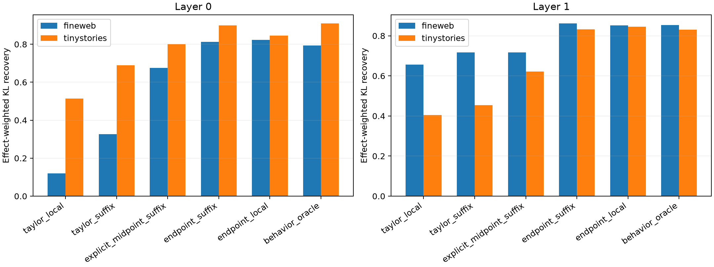

# Suffix-Fisher channel selection

A frozen Taylor product-change estimate is contracted through the exact midpoint suffix Jacobian and the output softmax-Fisher metric. Channels are ranked by `|v_i [J'FJv]_i|`; actual finite endpoint deltas are inspected only after selection and patched through the complete base suffix.

## Locked hypotheses

- **F0_suffix_fisher_contraction_is_numerically_valid: supported.**
- **F1_suffix_conditioned_taylor_preserves_behavior: not supported.**
- **F2_suffix_conditioning_beats_local_scoring: not supported.**
- **F3_suffix_conditioning_closes_half_the_endpoint_gap: not supported.**
- **F4_endpoint_direction_plus_suffix_metric_is_strong: supported.**
- **F5_explicit_midpoint_identifies_truncation_cost: not supported.**
- **F6_suffix_conditioned_selector_transfers_ood: not supported.**
- **F7_high_effect_behavior_is_preserved: not supported.**
- **F8_selector_is_prospective: supported.**

| Layer | Corpus | Taylor suffix/local | Explicit/endpoint suffix | Endpoint local/oracle | Taylor suffix median/q25 | High-effect suffix |
|---:|---|---:|---:|---:|---:|---:|
| 0 | fineweb | 0.327/0.121 | 0.675/0.813 | 0.823/0.793 | 0.507/0.302 | 0.314 |
| 0 | tinystories | 0.689/0.514 | 0.800/0.900 | 0.846/0.909 | 0.506/0.216 | 0.716 |
| 1 | fineweb | 0.717/0.657 | 0.717/0.861 | 0.852/0.853 | 0.502/0.277 | 0.750 |
| 1 | tinystories | 0.453/0.404 | 0.621/0.833 | 0.845/0.831 | 0.472/0.168 | 0.524 |
