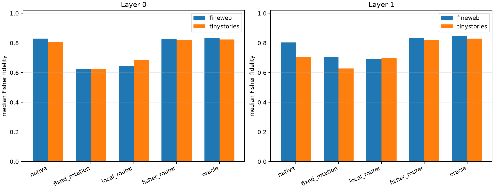

# Prospective suffix-Fisher adaptive chart router

For each native or rotated rank-256 midpoint program, the selected product tangent is written through the native Down matrix and propagated through the exact remaining tensor-network JVP at the midpoint state. Chart choice maximizes predicted softmax-Fisher fidelity to the full tangent. The router never sees the finite endpoint logits used for evaluation.

## Locked hypotheses

- **F0_batched_suffix_jvp_is_numerically_correct: not supported.**
- **F1_suffix_fisher_router_recovers_the_midpoint_chart_oracle: supported.**
- **F2_suffix_fisher_router_beats_local_router: supported.**
- **F3_suffix_fisher_adaptive_dictionary_beats_native: not supported.**
- **F4_suffix_fisher_router_closes_half_the_chart_oracle_gap: supported.**
- **F5_output_conditioning_changes_chart_choice: supported.**
- **F6_suffix_router_transfers_ood: supported.**

| Layer | Corpus | Native / fixed / local router / suffix-Fisher router / oracle | Fisher−native pair median (95% CI) | Fisher↔oracle agreement | Fisher/local disagreement | Suffix JVP min cosine / max error |
|---:|---|---:|---:|---:|---:|---:|
| 0 | fineweb | 0.829/0.627/0.647/0.827/0.833 | -0.006 (-0.044, +0.033) | 0.784 | 0.902 | 0.987128/0.1602 |
| 0 | tinystories | 0.807/0.621/0.683/0.821/0.824 | +0.006 (-0.005, +0.141) | 0.863 | 0.804 | 0.925516/0.3863 |
| 1 | fineweb | 0.803/0.704/0.690/0.835/0.846 | +0.056 (-0.023, +0.160) | 0.804 | 0.902 | 0.995766/0.0920 |
| 1 | tinystories | 0.703/0.628/0.699/0.820/0.830 | +0.045 (+0.002, +0.134) | 0.706 | 0.745 | 0.989489/0.1449 |

This is a stronger tensor explanation than local write fidelity because it contracts the chart through all downstream weights and the output metric. Failure would mean the per-example best-of-seven finite chart depends on curvature or finite interactions not captured by one midpoint tangent, rather than merely on choosing the correct local norm.
