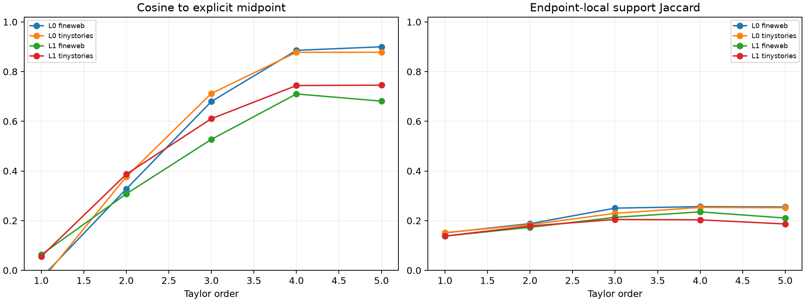

# Why the frozen Taylor behavioral compiler failed

This diagnostic replays the exact 192 random-token substitutions without refitting orders or sites. It separates derivative truncation, midpoint-versus-finite-path error, support recovery, output scoring, and embedding chord length.

## Locked hypotheses

- **D0_sites_reproduce_exactly: supported.**
- **D1_frozen_series_predicts_midpoint_direction: not supported.**
- **D2_midpoint_direction_predicts_finite_endpoint: not supported.**
- **D3_frozen_series_predicts_endpoint_support: not supported.**
- **D4_layer0_failure_is_truncation: not supported.**
- **D5_local_output_scoring_beats_magnitude: not supported.**
- **D6_longer_edits_reduce_behavioral_recovery: not supported.**
- **D7_semantic_edits_are_geometrically_easier: supported.**
- **D8_support_overlap_predicts_behavior: not supported.**
- **D9_diagnosis_does_not_refit_orders: supported.**

Semantic-pair median normalized-embedding chord: **28.160**.

| Layer | Corpus | Random chord | Frozen midpoint cosine / endpoint cosine / local support | Frozen local/magnitude write fidelity | Chord→behavior rho | Support→behavior rho |
|---:|---|---:|---:|---:|---:|---:|
| 0 | fineweb | 38.197 | 0.680/0.866/0.250 | 0.454/0.460 | -0.061 | 0.312 |
| 0 | tinystories | 38.441 | 0.712/0.814/0.229 | 0.487/0.486 | -0.128 | 0.240 |
| 1 | fineweb | 38.197 | 0.681/0.760/0.210 | 0.417/0.412 | 0.129 | 0.402 |
| 1 | tinystories | 38.441 | 0.745/0.781/0.187 | 0.403/0.418 | -0.150 | 0.354 |
