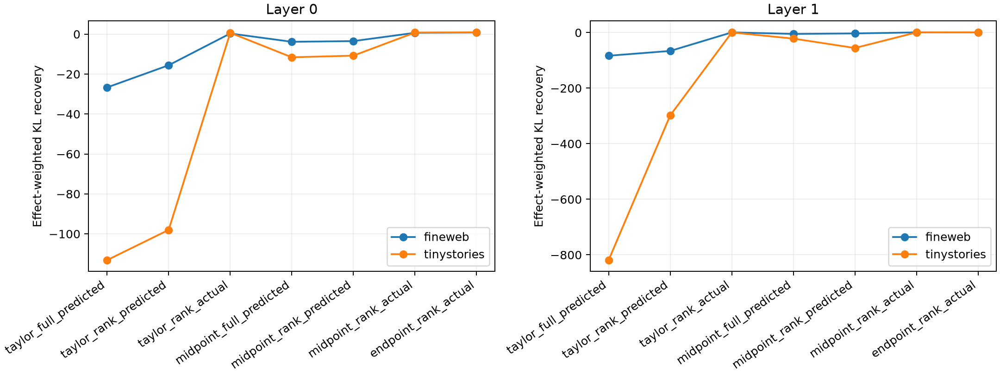

# Weighted versus hard coalition decomposition

The prospective Taylor or exact-midpoint product vector is compared as a continuous all-channel patch, a suffix-Fisher-selected rank-256 predicted-value patch, and the same rank-256 support populated with exact finite endpoint values. This separates vector prediction, hard support, and endpoint-value errors.

## Locked hypotheses

- **W0_endpoint_reference_recomposes: supported.**
- **W1_continuous_prediction_beats_hard_prediction: not supported.**
- **W2_exact_values_materially_help_predicted_support: supported.**
- **W3_midpoint_direction_improves_continuous_prediction: supported.**
- **W4_continuous_taylor_is_behaviorally_useful: not supported.**
- **W5_hard_support_is_not_the_only_failure: supported.**
- **W6_weighted_decomposition_transfers_ood: not supported.**
- **W7_no_endpoint_values_enter_prospective_predictions: supported.**

| Layer | Corpus | Taylor full/rank-pred/rank-actual | Midpoint full/rank-pred/rank-actual | Endpoint rank actual |
|---:|---|---:|---:|---:|
| 0 | fineweb | -26.672/-15.565/0.327 | -3.822/-3.475/0.675 | 0.813 |
| 0 | tinystories | -113.150/-98.022/0.689 | -11.575/-10.765/0.800 | 0.900 |
| 1 | fineweb | -83.294/-66.026/0.717 | -4.691/-3.068/0.717 | 0.861 |
| 1 | tinystories | -818.934/-298.161/0.453 | -21.560/-55.454/0.621 | 0.833 |
