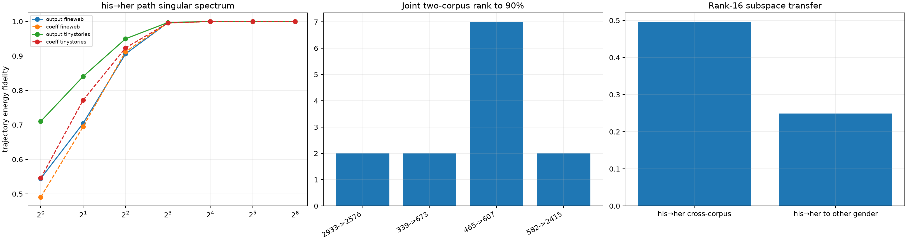

# Canonical path subspaces for diffuse layer-0 MLP channels

Hundreds of native bilinear channels were required to reproduce the sharp local MLP derivative. This audit stacks the derivative along each 129-point token path and computes uncentered singular subspaces in both residual-output space and native post-product coefficient space. Cross-corpus and cross-edit transfer distinguish per-path compression from a reusable semantic basis.

## Locked hypotheses

- **S1_each_anomalous_mlp_path_is_low_dimensional: supported.**
- **S2_native_channel_coefficients_follow_few_path_modes: supported.**
- **S3_the_joint_anomalous_pair_has_a_compact_subspace: supported.**
- **S4_the_path_subspace_transfers_across_corpora: not supported.**
- **S5_cross_corpus_subspaces_are_aligned: supported.**
- **S6_the_subspace_is_edit_specific_not_a_generic_gender_basis: supported.**
- **S7_sixteen_canonical_directions_beat_sixtyfour_native_channels: supported.**
- **S8_the_finite_mlp_change_lies_in_the_path_subspace: supported.**
- **S9_sharpness_does_not_require_higher_path_rank: not supported.**
- **S10_gender_paths_share_a_moderately_compact_joint_subspace: supported.**

| Corpus | Pair | Output rank90/rank99 | Coefficient rank90/rank99 | Output rank-16 fidelity | Finite-delta rank-8 fidelity |
|---|---|---:|---:|---:|---:|
| fineweb | 339->673 | 2/2 | 2/2 | 1.000 | 1.000 |
| fineweb | 465->607 | 4/7 | 4/8 | 1.000 | 1.000 |
| fineweb | 582->2415 | 1/2 | 2/2 | 1.000 | 1.000 |
| fineweb | 2933->2576 | 1/2 | 1/2 | 1.000 | 1.000 |
| tinystories | 339->673 | 2/2 | 2/2 | 1.000 | 1.000 |
| tinystories | 465->607 | 3/7 | 4/8 | 1.000 | 1.000 |
| tinystories | 582->2415 | 2/2 | 2/2 | 1.000 | 1.000 |
| tinystories | 2933->2576 | 1/2 | 1/2 | 1.000 | 1.000 |

Joint his→her rank-90%: **7**. All-gender joint rank-90%: **8**. Rank-16 cross-corpus his→her transfer: **0.496**; transfer into other gender edits: **0.249**. Rank-16 canonical alignment: **0.313**.

A compact path subspace is a shorter coordinate system for one family of interventions. It becomes a reusable circuit description only to the extent that it transfers to new contexts and examples; per-path SVD alone is descriptive compression.
