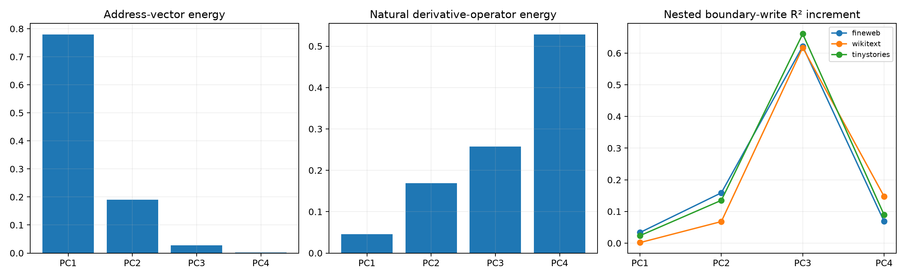

# Gain audit for the Layer-11 address contrast code

The four recovered native edit vectors are highly redundant. This audit rotates them into principal directions and compares how much address-vector energy each direction carries with its natural derivative-operator gain and its incremental contribution to real newline-induced state and MLP-write changes.

## Locked hypotheses

- **W1_address_energy_predicts_causal_importance: not supported.**
- **W2_low_energy_contrasts_dominate_boundary_write: supported.**
- **W3_shared_backbone_is_redundant_for_boundary_write: supported.**
- **W4_weight_operator_gain_favors_contrasts: supported.**
- **W5_real_boundary_changes_use_contrasts: supported.**
- **W6_fourth_direction_is_not_numerical_junk: supported.**

Spearman(address energy, mean causal increment): `-0.400`.

| Direction | Address energy | Operator energy | Mean write-R² increment | Amplification |
|---|---:|---:|---:|---:|
| PC1 | 0.7798 | 0.0456 | 0.0196 | 0.03x |
| PC2 | 0.1903 | 0.1689 | 0.1207 | 0.63x |
| PC3 | 0.0281 | 0.2571 | 0.6332 | 22.55x |
| PC4 | 0.0019 | 0.5284 | 0.1019 | 53.68x |

| Corpus | Contrast share of captured state | Contrast share of write R² | PC4 write increment |
|---|---:|---:|---:|
| fineweb | 0.710 | 0.782 | 0.069 |
| wikitext | 0.664 | 0.916 | 0.148 |
| tinystories | 0.740 | 0.825 | 0.089 |

The leading native edit component describes what the four addresses share, but shared coordinate magnitude is not causal importance. Low-energy contrast directions separate which output response is required and are strongly amplified by the bilinear map. This is an explicit discriminator code: redundancy supplies a common semantic family, while small differences carry the operative information.
