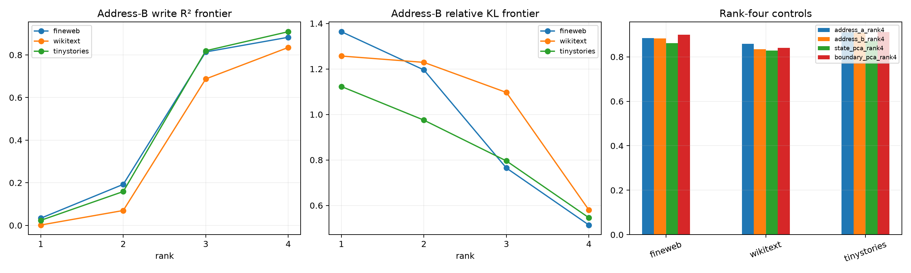

# Rank and cross-covariance stability of the Layer-11 natural boundary path

The full address span captures real newline-induced MLP changes, but its native edit vectors are ill-conditioned and its weakest canonical direction is less stable. This follow-up compares rank-one through rank-four address PCA spaces from two independent covariance samples against matched natural-state and supervised boundary-delta PCA controls.

## Locked hypotheses

- **S1_rank3_retains_full_address_write: not supported.**
- **S2_full_address_function_is_cross_slice_stable: not supported.**
- **S3_rank2_address_is_write_sufficient: not supported.**
- **S4_rank1_address_is_not_write_sufficient: supported.**
- **S5_weight_addresses_beat_state_pca_at_rank4: supported.**
- **S6_weight_addresses_approach_supervised_boundary_pca: supported.**
- **S7_logit_sufficiency_remains_unresolved: supported.**
- **S8_weak_address_directions_are_causally_necessary: supported.**

Native address singular values, slice A/B: `[1.7669, 0.8724, 0.3347, 0.0715]` / `[1.7661, 0.8724, 0.3352, 0.0871]`.

| Corpus/space | State energy | Write R² | Relative KL |
|---|---:|---:|---:|
| fineweb/address_a_rank2 | 0.145 | 0.199 | 1.196 |
| fineweb/address_a_rank3 | 0.500 | 0.807 | 0.840 |
| fineweb/address_a_rank4 | 0.510 | 0.885 | 0.471 |
| fineweb/address_b_rank2 | 0.147 | 0.192 | 1.196 |
| fineweb/address_b_rank3 | 0.497 | 0.814 | 0.765 |
| fineweb/address_b_rank4 | 0.507 | 0.883 | 0.514 |
| fineweb/state_pca_rank4 | 0.528 | 0.861 | 0.615 |
| fineweb/boundary_pca_rank4 | 0.598 | 0.900 | 0.380 |
| wikitext/address_a_rank2 | 0.141 | 0.063 | 1.223 |
| wikitext/address_a_rank3 | 0.422 | 0.681 | 1.178 |
| wikitext/address_a_rank4 | 0.437 | 0.858 | 0.449 |
| wikitext/address_b_rank2 | 0.146 | 0.070 | 1.229 |
| wikitext/address_b_rank3 | 0.423 | 0.687 | 1.097 |
| wikitext/address_b_rank4 | 0.435 | 0.835 | 0.580 |
| wikitext/state_pca_rank4 | 0.463 | 0.829 | 0.694 |
| wikitext/boundary_pca_rank4 | 0.498 | 0.840 | 0.497 |
| tinystories/address_a_rank2 | 0.133 | 0.160 | 0.969 |
| tinystories/address_a_rank3 | 0.523 | 0.811 | 0.887 |
| tinystories/address_a_rank4 | 0.537 | 0.910 | 0.485 |
| tinystories/address_b_rank2 | 0.139 | 0.159 | 0.975 |
| tinystories/address_b_rank3 | 0.522 | 0.819 | 0.796 |
| tinystories/address_b_rank4 | 0.534 | 0.909 | 0.546 |
| tinystories/state_pca_rank4 | 0.549 | 0.871 | 0.693 |
| tinystories/boundary_pca_rank4 | 0.621 | 0.911 | 0.408 |

Functional agreement across independently estimated spaces is stronger evidence than geometric canonical overlap alone. The rank frontier identifies whether the low-variance native edit directions are harmless redundancy or causally amplified coordinates. Behaviorally important weak directions are compatible with an ill-conditioned but reproducible tensor program.
