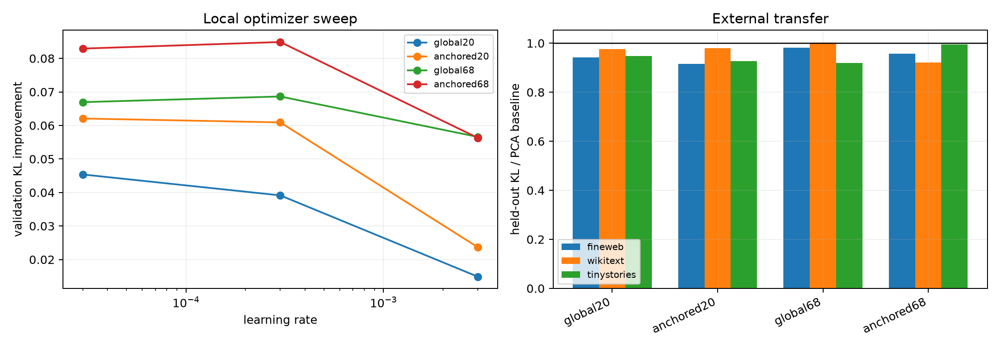

# Layer-11 behavior-subspace optimizer red team

The failed aggressive exact-KL optimization is red-teamed with zero-noise local starts and three learning rates. Selection uses only interleaved FineWeb validation KL; selected bases are frozen before disjoint FineWeb, WikiText, and TinyStories evaluation.

## Locked hypotheses

- **R1_local_optimization_improves_validation: supported.**
- **R2_rank20_gain_survives_external_data: not supported.**
- **R3_rank68_reaches_near_sufficiency: not supported.**
- **R4_behavior_fit_trades_away_variance: supported.**
- **R5_anchor_is_not_costly: supported.**

| Fit | Selected LR | Step | Validation improvement |
|---|---:|---:|---:|
| global20 | 3e-05 | 325 | 4.5% |
| anchored20 | 3e-05 | 475 | 6.2% |
| global68 | 3e-04 | 25 | 6.9% |
| anchored68 | 3e-04 | 125 | 8.5% |

| Corpus | PCA20 / global20 | Raw+tail16 / anchored20 | PCA68 / global68 | Raw+tail64 / anchored68 |
|---|---:|---:|---:|---:|
| fineweb | 0.08864 / 0.08354 | 0.09346 / 0.08556 | 0.06562 / 0.06440 | 0.06593 / 0.06305 |
| wikitext | 0.10066 / 0.09829 | 0.09871 / 0.09679 | 0.07214 / 0.07232 | 0.07448 / 0.06854 |
| tinystories | 0.08061 / 0.07631 | 0.08259 / 0.07652 | 0.05849 / 0.05379 | 0.05851 / 0.05817 |

Small local improvements would validate a metric mismatch without establishing a compact circuit. The near-sufficiency gate remains the decisive test. If a fixed rank-68 space stays far above it, the remaining candidates are context routing, nonlinear reconstruction, or genuinely broad support—not merely an unlucky PCA ordering.
