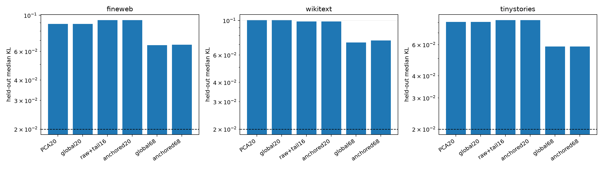

# Layer-11 exact-behavior subspace red team

Fixed output subspaces are optimized on 256 FineWeb training examples for exact native-to-reconstruction KL, selected on 256 interleaved validation examples, and frozen before evaluation on disjoint FineWeb, WikiText, and TinyStories. `global` fits may rotate all directions; `anchored` fits must retain the four weight-only spectral outliers and optimize only the remaining directions.

## Locked hypotheses

- **E1_anchored20_improves_tail_pca: not supported.**
- **E2_global20_improves_natural_pca: not supported.**
- **E3_rank68_reaches_near_sufficiency: not supported.**
- **E4_rank20_solutions_are_seed_stable: supported.**
- **E5_improvement_replicates_across_seeds: not supported.**
- **E6_weight_anchor_is_not_costly: supported.**
- **E7_behavioral_fit_is_not_just_more_variance: not supported.**

| Corpus | Natural-20 | Global-20 s0 / s1 | Raw4+tail16 | Anchored-20 s0 / s1 | Global-68 | Anchored-68 |
|---|---:|---:|---:|---:|---:|---:|
| fineweb | 0.08864 | 0.08864 / 0.08864 | 0.09346 | 0.09346 / 0.09346 | 0.06562 | 0.06593 |
| wikitext | 0.10066 | 0.10066 / 0.10066 | 0.09871 | 0.09871 / 0.09871 | 0.07214 | 0.07448 |
| tinystories | 0.08061 | 0.08061 / 0.08061 | 0.08259 | 0.08259 / 0.08259 | 0.05849 | 0.05851 |

Rank-20 seed overlap (mean canonical cosine): global **1.000**, anchored **1.000**.

A successful fixed behavior subspace would show that the missing tail is compact but hidden by a variance metric. Failure would instead point toward context-routed subspaces, nonlinear reconstruction, or genuinely broad final-layer output support. Exact-KL optimization is deliberately allowed to sacrifice write variance, so variance and behavior can be separated directly.
