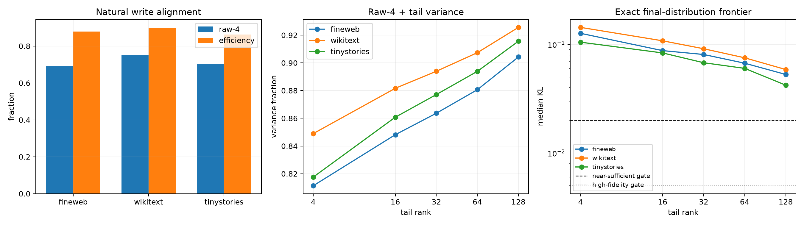

# Independent Layer-11 spectral bottleneck and residual-tail replication

Four output directions are frozen from the complete bilinear weight tensor. An 8,192-state FineWeb panel supplies the post-write mean, an orthogonal residual-tail PCA basis, and an unconstrained natural PCA control. Disjoint FineWeb, WikiText, and TinyStories panels test transfer. Causal projections use the full post-bias MLP write and recompute final RMSNorm and unembedding exactly.

## Locked hypotheses

- **T1_raw4_is_cross_corpus_natural_bottleneck: supported.**
- **T2_raw4_alone_is_behaviorally_sufficient: not supported.**
- **T3_raw4_plus_tail16_is_near_sufficient: not supported.**
- **T4_raw4_plus_tail64_is_high_fidelity: not supported.**
- **T5_tail16_is_stable_and_compact: supported.**
- **T6_learned_tail_beats_random_tail: not supported.**
- **T7_weight_anchored_program_beats_unconstrained_pca: not supported.**
- **T8_full_projection_is_identity: supported.**

| Corpus | Raw-4 variance / optimal efficiency | Tail effective rank | Tail top-16 fraction | Tail-16 transfer cosine / efficiency |
|---|---:|---:|---:|---:|
| fineweb | 0.693 / 0.878 | 21.2 | 0.521 | 0.911 / 0.972 |
| wikitext | 0.753 / 0.899 | 18.2 | 0.573 | 0.778 / 0.910 |
| tinystories | 0.705 / 0.863 | 14.6 | 0.619 | 0.730 / 0.852 |

| Corpus | Raw-4 KL | + tail-16 | + tail-64 | Natural-20 | Raw-4 + random-16 | Full median abs. KL |
|---|---:|---:|---:|---:|---:|---:|
| fineweb | 0.18607 | 0.08765 | 0.06714 | 0.08676 | 0.18006 | 7.91e-09 |
| wikitext | 0.18776 | 0.10796 | 0.07529 | 0.10446 | 0.18930 | 7.28e-09 |
| tinystories | 0.15660 | 0.08349 | 0.06019 | 0.08551 | 0.15538 | 7.94e-09 |

The decisive distinction is between a direction being unusually strong, naturally used, necessary, and sufficient. A low-dimensional outlier space can be real and causally important while remaining far from a sufficient program. The learned residual-tail comparison asks whether the remaining computation is compact and transferable; the natural-PCA and random-tail controls test whether weight anchoring adds anything beyond ordinary write covariance.
