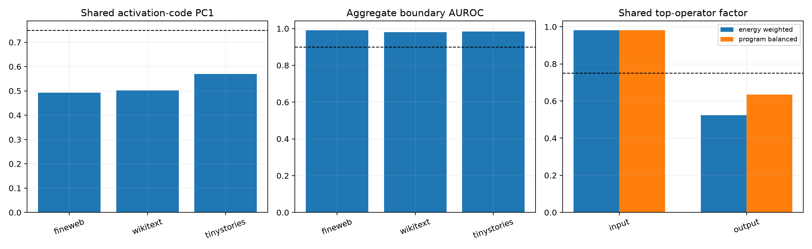

# Layer-11 boundary-code audit

All four compact Layer-11 address programs have cross-corpus current-newline selectivity that survived literal token edits. This audit asks whether they are four views of one geometric feature, one input predicate fanning out to several output verbs, or semantically related but geometrically multiplexed programs.

## Locked hypotheses

- **B1_boundary_scores_form_one_activation_code: not supported.**
- **B2_top_operators_share_one_input_covector: supported.**
- **B3_top_operators_have_distinct_output_verbs: not supported.**
- **B4_aggregate_code_predicts_boundaries_ood: supported.**
- **B5_shared_semantics_do_not_explain_all_score_variation: not supported.**
- **B6_native_implementations_are_distinct: not supported.**
- **B7_native_address_axes_are_individually_stable: supported.**
- **B8_native_address_span_is_ill_conditioned: supported.**

Polarity-aligned address roles: `{'0': 'negative', '1': 'positive', '2': 'positive', '3': 'negative'}`. Matched cross-slice edit cosines: `[1.0, 0.998, 0.999, 0.988]`. Edit-Gram conditions: `609.9` / `410.8`.

Singular-weighted common input/output fractions: `0.981` / `0.523`. Program-balanced fractions: `0.982` / `0.634`. Normalized top-rank energy weights: `[0.147, 0.156, 0.236, 0.461]`.
Pairwise absolute input/output cosines: `[0.99, 0.961, 0.976, 0.99, 0.978, 0.96]` / `[0.891, 0.627, 0.104, 0.726, 0.132, 0.166]`. Median native top-32 Jaccard: `0.314`.

| Corpus | Activation PC1 | Boundary AUROC | Residual correlation | Newlines |
|---|---:|---:|---:|---:|
| fineweb | 0.493 | 0.992 | 0.398 | 159 |
| wikitext | 0.502 | 0.981 | 0.414 | 83 |
| tinystories | 0.570 | 0.984 | 0.272 | 254 |

The result is a partially shared fan-out program. All four top operators read nearly the same natural-metric input covector, but their output directions range from strongly aligned to nearly orthogonal, their native channel sets overlap only moderately, and their corpus activation scores retain roughly two effective dimensions plus correlated residual variation. The reusable object is therefore a shared boundary-reading backbone with multiplexed output verbs—not one monosemantic neuron, four unrelated codes, or one fully collapsed activation scalar.
