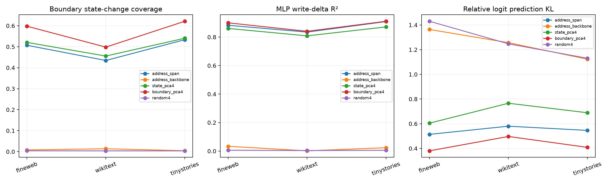

# Natural-path red team for the Layer-11 boundary program

The recovered addresses define compact derivatives whose context covectors detect boundaries. This test asks the stronger question: do real ordinary-token-to-newline state changes enter the address span, and does that span reproduce the resulting MLP write and final-logit effects? Random four-spaces, natural-state PCA, and a separately fitted boundary-delta PCA are controls.

## Locked hypotheses

- **N1_boundary_changes_enter_address_span: supported.**
- **N2_address_span_captures_boundary_mlp_write: supported.**
- **N3_address_span_predicts_boundary_mlp_logits: not supported.**
- **N4_shared_address_backbone_is_sufficient: not supported.**
- **N5_address_span_beats_unsupervised_state_pca: supported.**
- **N6_supervised_boundary_pca_is_an_upper_bound: supported.**
- **N7_layer11_mlp_path_is_material_to_full_token_edit: not supported.**
- **N8_address_advantage_transfers_ood: supported.**

| Corpus/space | State energy | Write R² | Relative prediction KL | MLP/full KL |
|---|---:|---:|---:|---:|
| fineweb/address_span | 0.507 | 0.883 | 0.514 | 0.145 |
| fineweb/address_backbone | 0.008 | 0.034 | 1.364 | 0.145 |
| fineweb/state_pca4 | 0.521 | 0.861 | 0.605 | 0.145 |
| fineweb/boundary_pca4 | 0.598 | 0.900 | 0.380 | 0.145 |
| fineweb/random4 | 0.004 | 0.006 | 1.430 | 0.145 |
| wikitext/address_span | 0.435 | 0.835 | 0.580 | 0.139 |
| wikitext/address_backbone | 0.014 | 0.002 | 1.257 | 0.139 |
| wikitext/state_pca4 | 0.456 | 0.808 | 0.766 | 0.139 |
| wikitext/boundary_pca4 | 0.498 | 0.840 | 0.497 | 0.139 |
| wikitext/random4 | 0.004 | 0.004 | 1.247 | 0.139 |
| tinystories/address_span | 0.534 | 0.909 | 0.546 | 0.097 |
| tinystories/address_backbone | 0.004 | 0.024 | 1.123 | 0.097 |
| tinystories/state_pca4 | 0.541 | 0.871 | 0.689 | 0.097 |
| tinystories/boundary_pca4 | 0.621 | 0.911 | 0.408 | 0.097 |
| tinystories/random4 | 0.004 | 0.006 | 1.131 | 0.097 |

A derivative can have a clean semantic context variable without lying on the natural causal path that produces the corresponding token transition. State coverage asks whether the upstream change enters the recovered tangent directions; exact projected MLP recomputation then tests nonlinear write and downstream behavior. The supervised boundary PCA is an upper bound for this specific edit, not a weight-only explanation.
