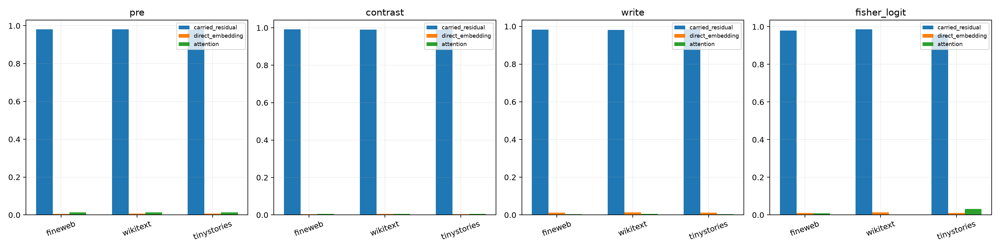

# Upstream path decomposition of the Layer-11 boundary contrasts

At the final block, the pre-MLP state is the sum of a carried residual term, a freshly injected normalized embedding, and attention output. For real final-token-to-newline edits, all eight factorial combinations of these three exact pre-state changes are evaluated. Vector Shapley allocations sum exactly to the changed normalized state, PC3–PC4 contrast, MLP write, and Fisher-centered final logits.

## Locked hypotheses

- **U1_one_path_dominates_boundary_contrast: supported.**
- **U2_dominant_contrast_path_is_reproducible: supported.**
- **U3_direct_embedding_exceeds_attention_for_contrast: not supported.**
- **U4_attention_is_material_for_final_logits: not supported.**
- **U5_state_contrast_and_mlp_write_have_similar_sources: supported.**
- **U6_vector_shapley_is_exact: supported.**
- **U7_path_interactions_are_small_for_state: supported.**
- **U8_path_interactions_are_material_for_mlp_write: not supported.**

| Corpus/metric | Carried | Embedding | Attention | Additive residual |
|---|---:|---:|---:|---:|
| fineweb/pre | 0.980 | 0.006 | 0.014 | nan |
| fineweb/state | 0.981 | 0.006 | 0.013 | 0.018 |
| fineweb/contrast | 0.991 | 0.003 | 0.005 | nan |
| fineweb/write | 0.983 | 0.012 | 0.004 | 0.041 |
| fineweb/fisher_logit | 0.980 | 0.011 | 0.009 | 0.064 |
| wikitext/pre | 0.980 | 0.007 | 0.013 | nan |
| wikitext/state | 0.979 | 0.007 | 0.014 | 0.017 |
| wikitext/contrast | 0.990 | 0.005 | 0.005 | nan |
| wikitext/write | 0.982 | 0.013 | 0.005 | 0.038 |
| wikitext/fisher_logit | 0.985 | 0.014 | 0.001 | 0.056 |
| tinystories/pre | 0.980 | 0.007 | 0.014 | nan |
| tinystories/state | 0.980 | 0.007 | 0.013 | 0.012 |
| tinystories/contrast | 0.991 | 0.004 | 0.005 | nan |
| tinystories/write | 0.984 | 0.013 | 0.004 | 0.038 |
| tinystories/fisher_logit | 0.957 | 0.011 | 0.032 | 0.068 |

Signed attributions are inner products between each exact vector-Shapley allocation and the full change, normalized so the three paths sum to one. Negative values indicate cancellation. The additive residual separately measures how wrong it would be to add the three factor-alone effects without their normalization and bilinear interactions.
