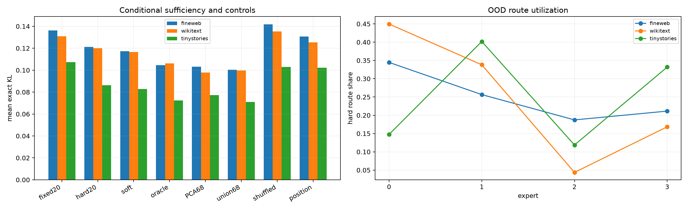

# Independent Layer-11 conditional output router

Four experts share the weight-only raw four-space and each learn a 16-dimensional tail. The expert bank has at most a 68-dimensional union, while hard execution retains 20 directions per token. A linear router sees only 64 frozen whitened PCA coordinates of the upstream normalized state. Training and validation split by FineWeb row; all bases and routes are frozen before disjoint FineWeb, WikiText, and TinyStories evaluation.

## Locked hypotheses

- **C1_hard_routed20_matches_fixed68: not supported.**
- **C2_hard_routed20_beats_fixed20: not supported.**
- **C3_router_closes_oracle_gap: not supported.**
- **C4_hard_retains_soft_gain: not supported.**
- **C5_router_uses_multiple_experts: supported.**
- **C6_context_assignment_matters: not supported.**
- **C7_context_beats_position_only: not supported.**
- **C8_oracle_experts_are_near_sufficient: not supported.**
- **C9_full_union_upper_bound: supported.**

| Corpus | Fixed-20 | Hard-20 | Soft mixture | Oracle expert | Fixed PCA-68 | Trained union-68 | Shuffled | Position-only |
|---|---:|---:|---:|---:|---:|---:|---:|---:|
| fineweb | 0.13632 | 0.12122 | 0.11727 | 0.10457 | 0.10304 | 0.10037 | 0.14178 | 0.13074 |
| fineweb route support | — | 3.89 experts | site entropy 0.52 | — | — | — | — | — |
| wikitext | 0.13087 | 0.11995 | 0.11656 | 0.10619 | 0.09793 | 0.09965 | 0.13534 | 0.12536 |
| wikitext route support | — | 3.20 experts | site entropy 0.47 | — | — | — | — | — |
| tinystories | 0.10723 | 0.08625 | 0.08284 | 0.07235 | 0.07728 | 0.07099 | 0.10285 | 0.10218 |
| tinystories route support | — | 3.55 experts | site entropy 0.58 | — | — | — | — | — |

The oracle asks whether the learned expert bank contains a compact per-example explanation; the router asks whether upstream state can select it. A soft-only improvement is an ensemble code, not sparse execution. A hard gain that disappears under shuffled and position-only routes is evidence for conditional computation. If the trained union succeeds while both oracle and router fail, the tail is simultaneous rather than routed at this granularity.
