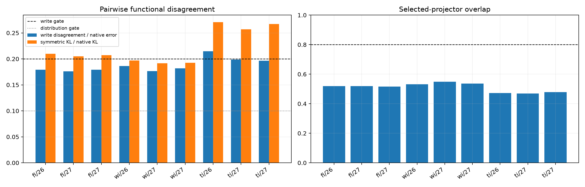

# Functional equivalence of unstable Layer-11 routers

The three seed fits have nearly identical aggregate native-distribution KL but different experts and route labels. This audit compares the actual hard-selected projectors, reconstructed writes, approximate output distributions, and per-example error profiles without aligning expert names.

## Locked hypotheses

- **E1_reconstructed_writes_are_equivalent: not supported.**
- **E2_output_distributions_are_equivalent: not supported.**
- **E3_selected_projectors_are_equivalent: not supported.**
- **E4_per_example_error_profiles_are_equivalent: supported.**
- **E5_approximation_top1_is_equivalent: not supported.**

| Corpus / seed pair | Write disagreement / native error | Symmetric KL / native KL | Projector overlap | Error correlation | Top-1 agreement |
|---|---:|---:|---:|---:|---:|
| fineweb / seed20261124__seed20261126 | 0.179 | 0.210 | 0.519 | 0.936 | 0.906 |
| fineweb / seed20261124__seed20261127 | 0.176 | 0.205 | 0.519 | 0.935 | 0.903 |
| fineweb / seed20261126__seed20261127 | 0.179 | 0.207 | 0.516 | 0.933 | 0.902 |
| wikitext / seed20261124__seed20261126 | 0.186 | 0.197 | 0.532 | 0.951 | 0.895 |
| wikitext / seed20261124__seed20261127 | 0.176 | 0.192 | 0.549 | 0.953 | 0.901 |
| wikitext / seed20261126__seed20261127 | 0.182 | 0.192 | 0.536 | 0.954 | 0.900 |
| tinystories / seed20261124__seed20261126 | 0.215 | 0.271 | 0.472 | 0.840 | 0.907 |
| tinystories / seed20261124__seed20261127 | 0.199 | 0.257 | 0.470 | 0.877 | 0.906 |
| tinystories / seed20261126__seed20261127 | 0.196 | 0.267 | 0.479 | 0.838 | 0.903 |

If writes and distributions agree despite projector disagreement, the decompositions are gauge choices for one stable function. If only aggregate error agrees, the training objective admits many inequivalent partial approximations; individual routes, experts, and reconstructed examples then cannot be interpreted as recovered native mechanisms.
