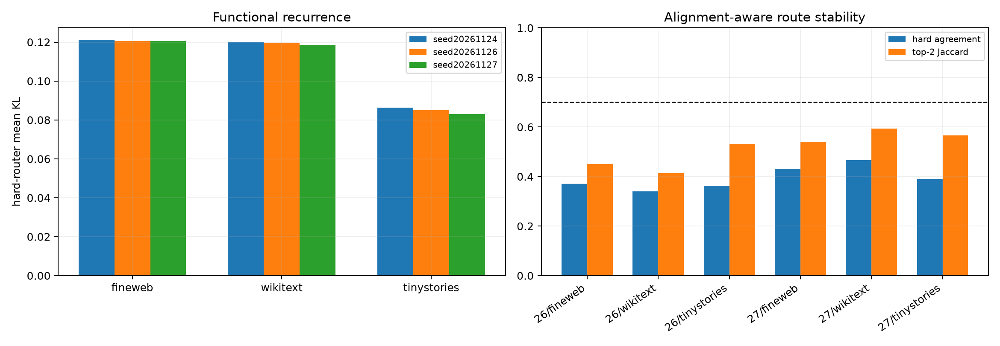

# Seed stability of the independent Layer-11 conditional router

Three programs use the same data split, frozen router coordinates, raw-four anchor, and 4×16 tail capacity but independent initialization and minibatch sampling. Expert names are aligned by the permutation maximizing mean tail-subspace canonical overlap before route agreement is measured.

## Locked hypotheses

- **S1_hard_performance_is_stable: supported.**
- **S2_expert_union_is_stable: not supported.**
- **S3_matched_expert_subspaces_are_stable: not supported.**
- **S4_hard_routes_are_stable: not supported.**
- **S5_top2_route_sets_are_stable: not supported.**
- **S6_contextual_gain_replicates: supported.**
- **S7_fixed68_gap_replicates: not supported.**

| Seed | Matched tail overlap | Union overlap | FineWeb hard KL | WikiText | TinyStories |
|---:|---:|---:|---:|---:|---:|
| 20261124 | 1.000 | 1.000 | 0.12122 | 0.11995 | 0.08625 |
| 20261126 | 0.593 | 0.610 | 0.12056 | 0.11959 | 0.08497 |
| 20261127 | 0.624 | 0.602 | 0.12067 | 0.11851 | 0.08298 |

| Restart / corpus | Hard route agreement | Top-2 Jaccard |
|---|---:|---:|
| seed20261126 / fineweb | 0.372 | 0.451 |
| seed20261126 / wikitext | 0.339 | 0.414 |
| seed20261126 / tinystories | 0.362 | 0.532 |
| seed20261127 / fineweb | 0.431 | 0.540 |
| seed20261127 / wikitext | 0.467 | 0.593 |
| seed20261127 / tinystories | 0.389 | 0.565 |

Stable performance with unstable expert identities would support a reproducible function class but a noncanonical internal decomposition. Stable aligned routes and subspaces would justify interpreting the individual experts. Failure of both says the original conditional gain is optimization-contingent.
