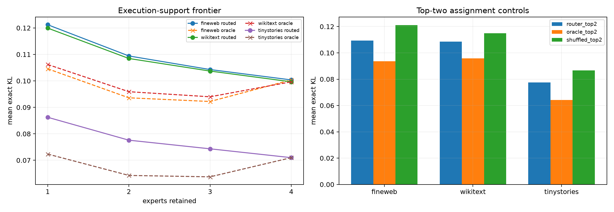

# Frozen top-k execution frontier for the independent Layer-11 router

The trained four-expert bank and upstream router are frozen. For each token, the top-k route selects the exact orthogonal union of its k expert tails plus the shared raw four-space, using 20/36/52/68 directions for k=1/2/3/4. Per-example oracle subsets, shuffled assignments, and fixed PCA spaces of the same rank are evaluated on the same states.

## Locked hypotheses

- **K1_top2_matches_full_union: supported.**
- **K2_top2_beats_fixed_rank36: not supported.**
- **K3_top2_router_closes_oracle_gap: not supported.**
- **K4_oracle_top2_is_near_sufficient: not supported.**
- **K5_top3_retains_most_union_gain: not supported.**
- **K6_top2_assignment_matters: not supported.**
- **K7_two_experts_are_enough: supported.**
- **K8_more_experts_monotonically_help: supported.**

| Corpus | Routed k=1 / 2 / 3 / 4 | Oracle k=1 / 2 / 3 / 4 | Fixed rank 20 / 36 / 52 / 68 | Minimum k within 10% |
|---|---:|---:|---:|---:|
| fineweb | 0.12122 / 0.10942 / 0.10428 / 0.10037 | 0.10457 / 0.09361 / 0.09221 / 0.10037 | 0.13632 / 0.12169 / 0.11187 / 0.10304 | 2 |
| wikitext | 0.11995 / 0.10846 / 0.10371 / 0.09965 | 0.10619 / 0.09591 / 0.09399 / 0.09965 | 0.13087 / 0.11673 / 0.10657 / 0.09793 | 2 |
| tinystories | 0.08625 / 0.07760 / 0.07434 / 0.07099 | 0.07235 / 0.06428 / 0.06375 / 0.07099 | 0.10723 / 0.09140 / 0.08322 / 0.07728 | 2 |

A low minimum k with a small router–oracle gap supports sparse conditional execution. A smooth improvement through k=4, especially when oracle subsets also need large k, supports simultaneous distributed tail use. Fixed-rank controls distinguish useful learned expert unions from merely adding dimensions. Oracle KL is not required to be monotone in k: Euclidean projection onto a larger output space can worsen final KL after RMSNorm and unembedding. Here oracle k=3 beats k=4, another direct instance of variance/write geometry disagreeing with the behavioral metric.
