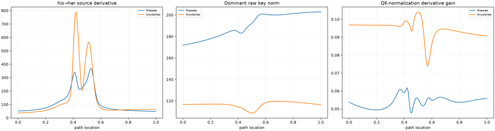

# QK-normalization red team of the layer-1 key-routing spike

For every gender edit in FineWeb and TinyStories, the layer-1 token path is sampled at 129 points. The dominant routing head's pre-QK-normalization key norm, raw key derivative, normalized key derivative, and full source derivative are compared. This tests a concrete replacement for the falsified attention-denominator-collapse explanation.

## Locked hypotheses

- **N1_key_norm_minimum_is_near_the_source_derivative_peak: not supported.**
- **N2_the_raw_key_has_a_large_norm_dip: not supported.**
- **N3_inverse_key_norm_tracks_source_sharpness: not supported.**
- **N4_qk_normalization_amplifies_the_peak: not supported.**
- **N5_the_norm_dip_is_specific_to_the_anomalous_pair: not supported.**
- **N6_the_dominant_routing_head_is_the_lowest_norm_key_head: not supported.**
- **N7_the_anomaly_has_larger_normalized_key_derivatives_than_controls: supported.**
- **N8_raw_key_derivatives_are_not_equally_anomalous: not supported.**
- **N9_head_identity_remains_context_dependent: supported.**
- **N10_qk_normalization_explains_more_than_attention_mass: not supported.**

| Corpus | Pair | Peak/min distance | Min/endpoint key norm | Inverse-norm correlation | Peak/endpoint gain | Dominant/min-norm head |
|---|---|---:|---:|---:|---:|---:|
| fineweb | 339->673 | 0.000 | 0.974 | 0.956 | 0.980 | H3 / H0 |
| fineweb | 465->607 | 0.531 | 0.917 | 0.093 | 0.944 | H2 / H0 |
| fineweb | 582->2415 | 0.898 | 0.987 | -0.796 | 1.031 | H4 / H0 |
| fineweb | 2933->2576 | 0.453 | 0.997 | -0.838 | 1.054 | H2 / H0 |
| tinystories | 339->673 | 1.000 | 0.983 | -0.861 | 1.048 | H4 / H0 |
| tinystories | 465->607 | 0.078 | 0.932 | 0.809 | 1.054 | H3 / H0 |
| tinystories | 582->2415 | 0.312 | 0.940 | 0.747 | 0.972 | H3 / H0 |
| tinystories | 2933->2576 | 0.227 | 0.951 | 0.777 | 0.918 | H2 / H0 |

QK normalization can amplify directional motion when a projected query or key has low raw norm. A norm dip would explain sharp but continuous routing without either a raw score zero-crossing or collapse of the attention row normalizer.
