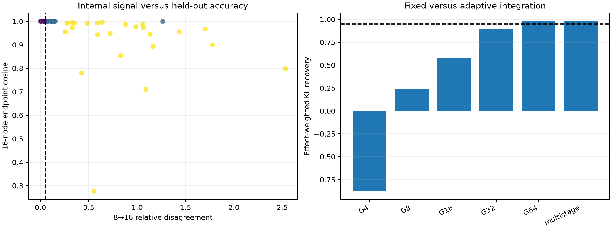

# Multistage layer-1 path quadrature

A prospective convergence rule stops each FineWeb token-edit path at 8, 16, 32, or 64 Gauss nodes. Each decision compares adjacent interior estimates; exact endpoint effects are evaluated only after the route is frozen.

## Locked hypotheses

- **M0_next_stage_flags_remaining_bad_paths: supported.**
- **M1_thirty_two_nodes_are_typically_exact_on_routed_paths: supported.**
- **M2_multistage_compiler_preserves_behavior: supported.**
- **M3_compact_support_preserves_behavior: supported.**
- **M4_internal_convergence_certifies_accuracy: supported.**
- **M5_routing_is_prospective: supported.**

Stop counts: `{'8': 22, '16': 5, '32': 12, '64': 25}`; mean selected node count: **35.0**.

Bad-16 routing recall: **1.000** (7 sites). Early-stop endpoint-cosine certification: **1.000**.

| Method | Effect-weighted KL recovery | Median | Q25 | Negative fraction |
|---|---:|---:|---:|---:|
| prediction_4 | -0.876 | 0.930 | -0.062 | 0.266 |
| prediction_8 | 0.242 | 0.996 | 0.704 | 0.125 |
| prediction_16 | 0.582 | 1.000 | 0.967 | 0.078 |
| prediction_32 | 0.891 | 1.000 | 1.000 | 0.031 |
| prediction_64 | 0.979 | 1.000 | 1.000 | 0.016 |
| multistage | 0.979 | 1.000 | 1.000 | 0.016 |
| multistage_rank_actual | 0.872 | 0.730 | 0.541 | 0.031 |
| endpoint_rank_actual | 0.861 | 0.741 | 0.549 | 0.047 |
