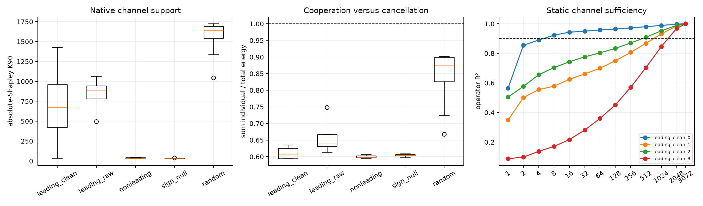

# Native-channel decomposition of Layer-5 spectral addresses

Each exact address-restricted derivative operator is written as the sum of 3,072 native rank-one channel operators. For squared Frobenius value, channel h has exact Shapley allocation `<C_h, sum_k C_k>`. Static prefixes are ranked by absolute Shapley allocation and tested by reconstructing the full covariance-weighted operator.

## Locked hypotheses

- **N1_channel_sum_and_shapley_identity_are_exact: supported.**
- **N2_leading_addresses_use_more_channels_than_sign_nulls: supported.**
- **N3_leading_addresses_are_not_single_channel: not supported.**
- **N4_sign_null_addresses_are_channel_localized: not supported.**
- **N5_leading_addresses_show_positive_cooperation: supported.**
- **N6_128_channels_are_sufficient_for_leading_addresses: not supported.**
- **N7_cleaning_increases_channel_distribution: not supported.**
- **N8_nonleading_compactness_is_channel_localized: not supported.**

| Address | Singular K90 | Channel Shapley K90 | Eff. channel support | Largest share | Individual/total energy | R² top-128 |
|---|---:|---:|---:|---:|---:|---:|
| leading_clean_0 | 2 | 35 | 4.0 | 0.428 | 0.595 | 0.965 |
| leading_clean_1 | 112 | 804 | 9.3 | 0.297 | 0.635 | 0.750 |
| leading_clean_2 | 63 | 549 | 5.7 | 0.397 | 0.594 | 0.834 |
| leading_clean_3 | 218 | 1428 | 156.4 | 0.068 | 0.622 | 0.452 |
| leading_raw_0 | 148 | 906 | 42.8 | 0.085 | 0.613 | 0.720 |
| leading_raw_1 | 46 | 496 | 2.8 | 0.599 | 0.748 | 0.858 |
| leading_raw_2 | 127 | 876 | 9.9 | 0.241 | 0.637 | 0.753 |
| leading_raw_3 | 171 | 1064 | 55.7 | 0.077 | 0.640 | 0.666 |
| nonleading_mode1 | 2 | 37 | 3.5 | 0.504 | 0.607 | 0.953 |
| nonleading_mode2 | 2 | 47 | 3.8 | 0.473 | 0.596 | 0.950 |
| nonleading_mode3 | 2 | 32 | 3.8 | 0.446 | 0.599 | 0.964 |

| Group | Median channel K90 | Effective support | Largest share | Individual/total energy | Negative Shapley mass |
|---|---:|---:|---:|---:|---:|
| leading_clean | 676.5 | 7.5 | 0.347 | 0.608 | 0.006 |
| leading_raw | 891.0 | 26.4 | 0.163 | 0.638 | 0.015 |
| nonleading | 37.0 | 3.8 | 0.473 | 0.599 | 0.008 |
| sign_null | 30.5 | 3.8 | 0.446 | 0.605 | 0.011 |
| random | 1642.5 | 435.3 | 0.045 | 0.876 | 0.003 |

Low singular rank and low channel support are different notions. A rank-two operator can be the coherent sum of many channels, while a high-rank operator can have a few dominant allocations plus a long corrective tail. `individual/total < 1` indicates net positive cooperation; values above one indicate cancellation. Static prefix sufficiency is reported separately from attribution support.
