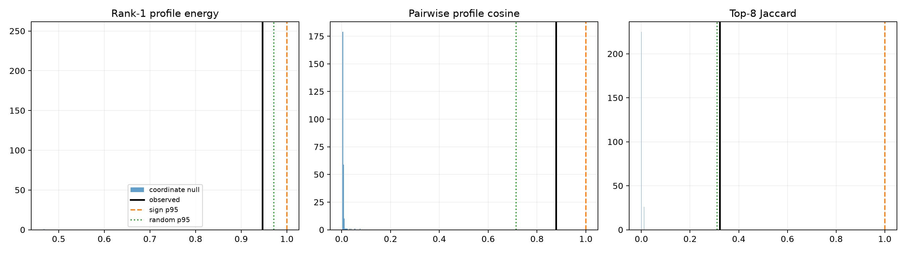

# Recurrence red team for the Layer-5 shared channel backbone

The four leading-address absolute-Shapley profiles are compared with 256 nulls that independently permute channel identities within each profile, preserving sparsity and marginal magnitudes. All four-profile subsets of the eight sign-null and eight random-address profiles provide matched empirical controls.

## Locked hypotheses

- **R1_rank1_profile_exceeds_coordinate_null: supported.**
- **R2_profile_cosine_exceeds_coordinate_null: supported.**
- **R3_top8_overlap_exceeds_coordinate_null: supported.**
- **R4_profile_recurrence_exceeds_sign_controls: not supported.**
- **R5_profile_recurrence_exceeds_random_controls: supported.**
- **R6_backbone_has_recurrent_channel_core: supported.**

Observed rank-one energy **0.946**, pairwise cosine **0.878**, and top-8 Jaccard **0.322**. Common top-8 channels: `[196, 202]`.

| Control | Rank-1 median / p95 | Cosine median / p95 | Jaccard median / p95 |
|---|---:|---:|---:|
| coordinate_permutation | 0.467 / 0.467 | 0.005 / 0.010 | 0.000 / 0.011 |
| sign_null | 0.996 / 1.000 | 0.994 / 1.000 | 1.000 / 1.000 |
| random | 0.956 / 0.972 | 0.546 / 0.714 | 0.194 / 0.312 |

A high first singular value is not enough because nonnegative sparse profiles share a mean direction. Coordinate permutation tests whether the same channel identities recur; sign/random groups test whether that recurrence is special to the leading weight-conditioned addresses.
