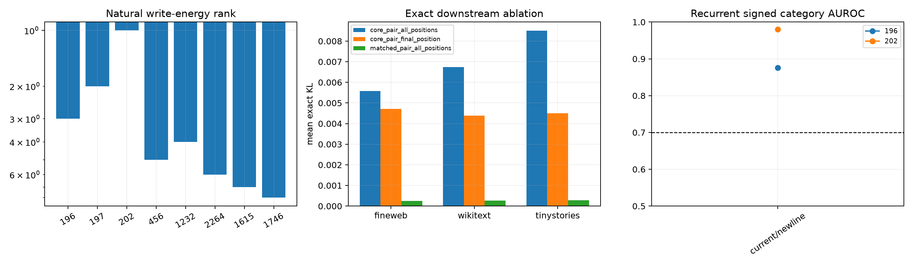

# Language and causal audit of recurrent Layer-5 backbone channels

Channels 196 and 202 recur in the top-eight attribution sets of all four leading spectral addresses. Channels 197 and 456 extend the aggregate backbone. Each is compared with a unique non-backbone channel matched by natural activation-weighted write energy. Signed activation semantics use frozen token categories on FineWeb, WikiText, and TinyStories. Exact zero ablations are run either at every Layer-5 position or only the final position, with layers 6–11 recomputed.

## Locked hypotheses

- **C1_core_channels_have_top1pct_weight_energy: not supported.**
- **C2_core_channels_have_top1pct_natural_write_energy: supported.**
- **C3_core_pair_is_more_causal_than_matched_pair: supported.**
- **C4_core_effect_is_attention_mediated: not supported.**
- **C5_core_has_recurrent_simple_semantics: supported.**
- **C6_core_is_more_aligned_with_leading_output: not supported.**
- **C7_core_pair_supports_observed_token_loss: not supported.**
- **C8_core_causal_effect_exceeds_individuals: supported.**

Matched controls: `{196: 1232, 197: 2264, 202: 1615, 456: 1746}`. Recurrent signed category features: `{'196': ['current/newline'], '202': ['current/newline']}`.

| Channel | Role | Tensor rank | Natural-energy rank | Leading-output cos² |
|---:|---|---:|---:|---:|
| 196 | core | 3072 | 3 | 0.2510 |
| 197 | extended | 10 | 2 | 0.8542 |
| 202 | core | 3071 | 1 | 0.0101 |
| 456 | extended | 55 | 5 | 0.8119 |
| 1232 | matched to 196 | 2545 | 4 | 0.2493 |
| 2264 | matched to 197 | 3068 | 6 | 0.0640 |
| 1615 | matched to 202 | 3070 | 7 | 0.2860 |
| 1746 | matched to 456 | 65 | 8 | 0.0014 |

| Corpus | Core pair all-pos KL / final-only KL | Matched pair KL | Core-pair CE Δ | Top-1 agreement |
|---|---:|---:|---:|---:|
| fineweb | 0.00557 / 0.00472 | 0.00024 | 0.00502 | 0.984 |
| wikitext | 0.00673 / 0.00438 | 0.00026 | -0.05229 | 0.969 |
| tinystories | 0.00850 / 0.00451 | 0.00029 | -0.00916 | 0.953 |

Large weight or activation rank makes a channel structurally prominent, not semantic. Recurrent held-out category selectivity supplies a descriptive neuron interpretation; exact ablation supplies necessity. A pair effect larger than the sum of individual KLs indicates downstream interaction, while whole-sequence versus final-position ablation separates attention-mediated propagation from a direct residual effect.
