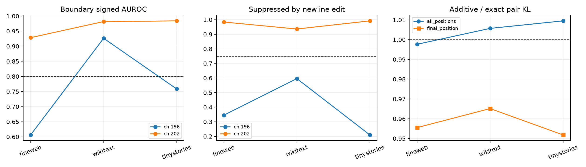

# Layer-5 core-channel mechanism red team

Fresh held-out slices test whether channels 196/202 are boundary-suppressed bilinear predicates and whether their apparently superadditive joint KL reflects an actual nonlinear circuit or ordinary additive-logit geometry.

## Locked hypotheses

- **M1_boundary_suppression_replicates: not supported.**
- **M2_product_is_more_boundary_selective_than_either_factor: not supported.**
- **M3_newline_substitution_suppresses_core: not supported.**
- **M4_pair_superadditivity_is_mostly_additive_logit_geometry: supported.**
- **M5_core_pair_has_positive_logit_coupling: supported.**
- **M6_activation_predicts_individual_causal_effect: not supported.**
- **M7_core_exceeds_matched_causal_effect: supported.**

## Boundary and substitution tests

| Corpus | Channel | Product AUROC/polarity | Better factor AUROC | Newline-edit suppression | Mean product change |
|---|---:|---:|---:|---:|---:|
| fineweb | 196 | 0.606/negative | 0.737 | 0.345 | 3.81 |
| fineweb | 202 | 0.929/negative | 0.910 | 0.984 | -57.82 |
| wikitext | 196 | 0.926/negative | 0.912 | 0.596 | -10.27 |
| wikitext | 202 | 0.982/negative | 0.969 | 0.936 | -60.22 |
| tinystories | 196 | 0.759/negative | 0.800 | 0.210 | 9.97 |
| tinystories | 202 | 0.984/negative | 0.971 | 0.992 | -49.41 |

## Pair geometry

| Corpus/scope | Exact pair KL | Sum individual KL | Additive/exact KL | Nonlinear residual | Fisher cosine | Core/matched KL |
|---|---:|---:|---:|---:|---:|---:|
| fineweb/all_positions | 0.00463 | 0.00364 | 0.998 | 0.072 | 0.362 | 16.8 |
| fineweb/final_position | 0.00464 | 0.00364 | 0.956 | 0.051 | 0.351 | 28.5 |
| wikitext/all_positions | 0.00548 | 0.00418 | 1.006 | 0.070 | 0.376 | 16.3 |
| wikitext/final_position | 0.00481 | 0.00325 | 0.965 | 0.054 | 0.426 | 34.3 |
| tinystories/all_positions | 0.00514 | 0.00396 | 1.009 | 0.066 | 0.426 | 17.1 |
| tinystories/final_position | 0.00337 | 0.00253 | 0.952 | 0.053 | 0.365 | 19.5 |

The factor comparison distinguishes a genuinely bilinear conjunction from a label already present in one linear factor. Literal token substitution is stronger than observational AUROC but still changes a real token embedding and therefore is not a minimal semantic intervention. The pair decomposition is decisive for the interaction claim: KL superadditivity by itself is expected whenever two additive logit changes are positively aligned in the softmax Fisher metric.
