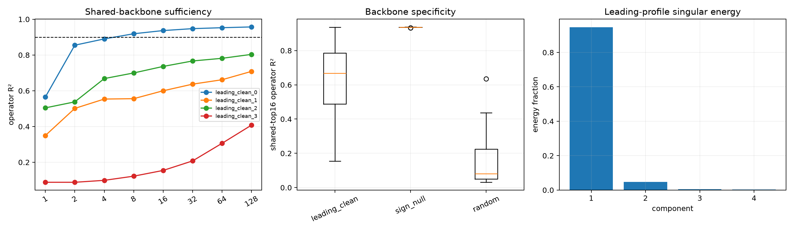

# Shared native-channel backbone of Layer-5 spectral addresses

A shared channel ranking is defined before testing sufficiency by averaging each leading address's normalized absolute Shapley profile. Frozen prefixes are then used to reconstruct every leading address and the sign-null/random controls. This separates recurrence of high-attribution channels from joint causal sufficiency.

## Locked hypotheses

- **B1_leading_top8_channels_recur: not supported.**
- **B2_shared_top4_captures_half_operator: not supported.**
- **B3_shared_top16_is_sufficient: not supported.**
- **B4_backbone_is_leading_address_specific: not supported.**
- **B5_shapley_profiles_have_shared_rank1_backbone: supported.**
- **B6_residual_after_backbone_remains_broad: supported.**
- **B7_backbone_channels_are_not_the_whole_circuit: supported.**
- **B8_shared_backbone_preserves_output_role: not supported.**

Leading top-eight mean pairwise Jaccard: **0.322**. Normalized-profile first singular energy: **0.946**. Aggregate backbone begins with channels `[202, 197, 196, 456, 1615, 2264, 3013, 1232, 276, 2535, 2519, 2003, 392, 2131, 2490, 2181]`.

| Address | R² shared 4 / 16 / 128 | Leading-output retention @16 | Full / residual singular K90 |
|---|---:|---:|---:|
| leading_clean_0 | 0.890 / 0.937 / 0.957 | 0.800 | 2 / 220 |
| leading_clean_1 | 0.554 / 0.600 / 0.708 | 0.407 | 112 / 231 |
| leading_clean_2 | 0.668 / 0.736 / 0.803 | 0.488 | 63 / 237 |
| leading_clean_3 | 0.099 / 0.154 / 0.408 | 0.059 | 218 / 238 |

The aggregate ranking is canonical only relative to the declared four addresses and Frobenius/Shapley metric. High top-k overlap establishes a reusable backbone; it does not establish that the backbone is sufficient. A broad residual after removing it is evidence for a backbone-plus-distributed-correction organization.
